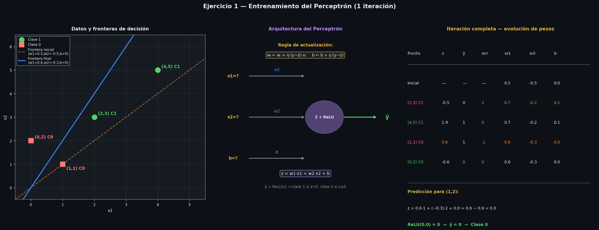

# Ejercicios resueltos: perceptrón, convolución 2D y redes en Keras

> Tema 4

---

## Ejercicio 1 — Entrenamiento del Perceptrón

**Configuración inicial:**

| Parámetro | Valor |
|-----------|-------|
| Pesos iniciales | $w_1 = 0.5$, $w_2 = -0.5$, $b = 0$ |
| Tasa de aprendizaje | $\eta = 0.1$ |
| Función de activación | ReLU |
| Criterio de clasificación | $\hat{y} = 1$ si $z > 0$, $\hat{y} = 0$ si $z \leq 0$ |

**Dataset:**

| Punto | Clase |
|-------|-------|
| (2, 3) | 1 |
| (4, 5) | 1 |
| (1, 1) | 0 |
| (0, 2) | 0 |

**Fórmulas del perceptrón:**

$$z = w_1 x_1 + w_2 x_2 + b$$

$$\hat{y} = \text{ReLU}(z) = \max(0, z) \xrightarrow{\text{umbral}} \begin{cases} 1 & \text{si } z > 0 \\ 0 & \text{si } z \leq 0 \end{cases}$$

**Regla de actualización de pesos (Perceptrón):**

$$w_i \leftarrow w_i + \eta \cdot (y - \hat{y}) \cdot x_i \qquad b \leftarrow b + \eta \cdot (y - \hat{y})$$

| Símbolo | Significado |
|---------|-------------|
| $\eta$ | Tasa de aprendizaje (learning rate) — controla el tamaño del ajuste |
| $y$ | Etiqueta real (0 o 1) |
| $\hat{y}$ | Predicción del modelo (0 o 1) |
| $y - \hat{y}$ | Error: 0 si correcto, +1 si falló positivo, −1 si falló negativo |



---

### Iteración completa

#### Punto 1: (2, 3) — Clase 1

$$z = 0.5 \cdot 2 + (-0.5) \cdot 3 + 0 = 1.0 - 1.5 + 0 = -0.5$$

$$\text{ReLU}(-0.5) = 0 \Rightarrow \hat{y} = 0$$

$$\text{error} = y - \hat{y} = 1 - 0 = +1 \quad \Rightarrow \text{ACTUALIZAR}$$

$$w_1 \leftarrow 0.5 + 0.1 \cdot 1 \cdot 2 = 0.5 + 0.2 = \mathbf{0.7}$$

$$w_2 \leftarrow -0.5 + 0.1 \cdot 1 \cdot 3 = -0.5 + 0.3 = \mathbf{-0.2}$$

$$b \leftarrow 0 + 0.1 \cdot 1 = \mathbf{0.1}$$

---

#### Punto 2: (4, 5) — Clase 1

$$z = 0.7 \cdot 4 + (-0.2) \cdot 5 + 0.1 = 2.8 - 1.0 + 0.1 = 1.9$$

$$\text{ReLU}(1.9) = 1.9 \Rightarrow \hat{y} = 1$$

$$\text{error} = 1 - 1 = 0 \quad \Rightarrow \text{sin cambio}$$

$$w_1 = 0.7 \qquad w_2 = -0.2 \qquad b = 0.1$$

---

#### Punto 3: (1, 1) — Clase 0

$$z = 0.7 \cdot 1 + (-0.2) \cdot 1 + 0.1 = 0.7 - 0.2 + 0.1 = 0.6$$

$$\text{ReLU}(0.6) = 0.6 \Rightarrow \hat{y} = 1$$

$$\text{error} = 0 - 1 = -1 \quad \Rightarrow \text{ACTUALIZAR}$$

$$w_1 \leftarrow 0.7 + 0.1 \cdot (-1) \cdot 1 = 0.7 - 0.1 = \mathbf{0.6}$$

$$w_2 \leftarrow -0.2 + 0.1 \cdot (-1) \cdot 1 = -0.2 - 0.1 = \mathbf{-0.3}$$

$$b \leftarrow 0.1 + 0.1 \cdot (-1) = 0.1 - 0.1 = \mathbf{0.0}$$

---

#### Punto 4: (0, 2) — Clase 0

$$z = 0.6 \cdot 0 + (-0.3) \cdot 2 + 0.0 = 0 - 0.6 + 0 = -0.6$$

$$\text{ReLU}(-0.6) = 0 \Rightarrow \hat{y} = 0$$

$$\text{error} = 0 - 0 = 0 \quad \Rightarrow \text{sin cambio}$$

$$w_1 = 0.6 \qquad w_2 = -0.3 \qquad b = 0.0$$

---

### Evolución de pesos

| Paso | Punto | $z$ | $\hat{y}$ | error | $w_1$ | $w_2$ | $b$ |
|------|-------|-----|-----------|-------|-------|-------|-----|
| Inicial | — | — | — | — | 0.5 | −0.5 | 0.0 |
| 1 | (2,3) C1 | −0.5 | 0 | **+1** | **0.7** | **−0.2** | **0.1** |
| 2 | (4,5) C1 | 1.9 | 1 | 0 | 0.7 | −0.2 | 0.1 |
| 3 | (1,1) C0 | 0.6 | 1 | **−1** | **0.6** | **−0.3** | **0.0** |
| 4 | (0,2) C0 | −0.6 | 0 | 0 | 0.6 | −0.3 | 0.0 |

**Pesos finales tras la iteración:**

$$\boxed{w_1 = 0.6 \qquad w_2 = -0.3 \qquad b = 0.0}$$

---

### Predicción para el punto (1, 2)

$$z = 0.6 \cdot 1 + (-0.3) \cdot 2 + 0.0 = 0.6 - 0.6 + 0.0 = 0.0$$

$$\text{ReLU}(0.0) = 0 \Rightarrow \hat{y} = 0 \Rightarrow \boxed{\textbf{Clase 0}}$$

El punto (1, 2) se clasifica como **clase 0** (no pertenece al grupo de (2,3) y (4,5)).

> **Nota:** $z = 0$ está exactamente en la frontera de decisión. Con el criterio $z > 0 \Rightarrow$ clase 1 y $z \leq 0 \Rightarrow$ clase 0, el punto cae en clase 0. El modelo necesitaría más iteraciones de entrenamiento para separar correctamente este punto frontera.

---

## Ejercicio 2 — Convolución 2D (CNN)

En las CNN, una imagen en escala de grises se representa como una matriz de píxeles. El proceso de convolución aplica un **filtro** (matriz de pesos) deslizándolo sobre la imagen para producir un **feature map** que detecta patrones locales.

**Datos del ejercicio:**

$$\text{Imagen } 3\times3 = \begin{pmatrix} 1 & 2 & 3 \\ 4 & 5 & 6 \\ 7 & 8 & 9 \end{pmatrix} \qquad \text{Filtro } 2\times2 = \begin{pmatrix} 1 & 0 \\ -1 & 1 \end{pmatrix}$$

Con stride=1 y sin padding, el output es de tamaño $(3-2+1) \times (3-2+1) = \mathbf{2 \times 2}$.

**Operación en cada posición:**

$$\text{output}(i,j) = \sum_{m}\sum_{n} \text{imagen}(i+m,\, j+n) \cdot \text{filtro}(m,n)$$

---

### Posición (0,0) — esquina superior izquierda

$$\begin{pmatrix} 1 & 2 \\ 4 & 5 \end{pmatrix} \odot \begin{pmatrix} 1 & 0 \\ -1 & 1 \end{pmatrix} = \begin{pmatrix} 1 & 0 \\ -4 & 5 \end{pmatrix} \quad \Rightarrow \quad 1+0+(-4)+5 = \mathbf{2}$$

### Posición (0,1) — desplazar una posición a la derecha

$$\begin{pmatrix} 2 & 3 \\ 5 & 6 \end{pmatrix} \odot \begin{pmatrix} 1 & 0 \\ -1 & 1 \end{pmatrix} = \begin{pmatrix} 2 & 0 \\ -5 & 6 \end{pmatrix} \quad \Rightarrow \quad 2+0+(-5)+6 = \mathbf{3}$$

### Posición (1,0) — bajar una fila, volver a la izquierda

$$\begin{pmatrix} 4 & 5 \\ 7 & 8 \end{pmatrix} \odot \begin{pmatrix} 1 & 0 \\ -1 & 1 \end{pmatrix} = \begin{pmatrix} 4 & 0 \\ -7 & 8 \end{pmatrix} \quad \Rightarrow \quad 4+0+(-7)+8 = \mathbf{5}$$

### Posición (1,1) — última posición

$$\begin{pmatrix} 5 & 6 \\ 8 & 9 \end{pmatrix} \odot \begin{pmatrix} 1 & 0 \\ -1 & 1 \end{pmatrix} = \begin{pmatrix} 5 & 0 \\ -8 & 9 \end{pmatrix} \quad \Rightarrow \quad 5+0+(-8)+9 = \mathbf{6}$$

---

### Resultado — Feature Map 2×2

$$\boxed{\begin{pmatrix} 2 & 3 \\ 5 & 6 \end{pmatrix}}$$

Cada valor representa cuánto "activa" el filtro en esa región de la imagen. En una CNN real, los valores del filtro se optimizan durante el entrenamiento mediante backpropagation para detectar automáticamente patrones relevantes (bordes, texturas, formas).

---

## Ejercicio 3 — Análisis de una FNN en Keras

### El código

```python
model = Sequential()
model.add(Dense(units=64, activation='relu', input_dim=10))
model.add(Dense(units=64, activation='relu'))
model.add(Dense(units=5,  activation='softmax'))
model.compile(optimizer='adam', loss='categorical_crossentropy', metrics=['accuracy'])
```

**`Sequential`:** modelo donde las capas se apilan en secuencia lineal — la salida de cada capa es la entrada de la siguiente. Equivale a una FNN (Feedforward Neural Network).

**`Dense`:** capa totalmente conectada (fully connected) — cada neurona está conectada con todas las de la capa anterior.

---

### Número de capas

El modelo tiene **3 capas Dense**:

```
Entrada (10 features)
      ↓
Capa 1 — Dense(64, relu)   ← capa oculta 1
      ↓
Capa 2 — Dense(64, relu)   ← capa oculta 2
      ↓
Capa 3 — Dense(5, softmax) ← capa de salida
```

> `input_dim=10` no es una capa — declara que cada dato de entrada tiene **10 features**.

---

### Volumen de cada capa

| Capa | Neuronas | Parámetros entrenables |
|------|----------|----------------------|
| Capa 1 (oculta) | **64** | $10 \times 64 + 64 = 704$ |
| Capa 2 (oculta) | **64** | $64 \times 64 + 64 = 4.160$ |
| Capa 3 (salida) | **5** | $64 \times 5 + 5 = 325$ |
| **Total** | | **5.189 parámetros** |

---

### Función de activación de cada capa

| Capa | Activación | Por qué |
|------|-----------|---------|
| Capa 1 | **ReLU** | No-linealidad, evita vanishing gradient, estándar en capas ocultas |
| Capa 2 | **ReLU** | Mismo motivo |
| Capa 3 | **Softmax** | Convierte 5 salidas en probabilidades que suman 1 → una por clase |

$$\text{softmax}(z_i) = \frac{e^{z_i}}{\sum_{j=1}^{5} e^{z_j}}$$

---

### Optimizador

**`adam`** (Adaptive Moment Estimation): combina Momentum y RMSprop. Adapta la tasa de aprendizaje individualmente para cada parámetro. Es el optimizador más usado por defecto en redes neuronales modernas.

$$w \leftarrow w - \frac{\eta}{\sqrt{\hat{v}} + \epsilon} \cdot \hat{m}$$

donde $\hat{m}$ es el gradiente con momento y $\hat{v}$ es la varianza adaptativa.

---

### Función de pérdida

**`categorical_crossentropy`**: mide la diferencia entre la distribución de probabilidades predicha y la etiqueta real:

$$\mathcal{L} = -\sum_{c=1}^{5} y_c \cdot \log(p_c)$$

| Símbolo | Significado |
|---------|-------------|
| $y_c$ | 1 si $c$ es la clase correcta, 0 si no (formato one-hot) |
| $p_c$ | Probabilidad predicha por softmax para la clase $c$ |

Requiere etiquetas en formato **one-hot** (ej: clase 3 de 5 → `[0, 0, 1, 0, 0]`).

---

### Métrica de evaluación

**`accuracy`**: porcentaje de predicciones correctas sobre el total.

$$\text{Accuracy} = \frac{\text{predicciones correctas}}{\text{total de ejemplos}}$$

Se monitoriza durante el entrenamiento pero **no interviene en la actualización de pesos** — eso lo hace exclusivamente la función de pérdida.

---

### ¿Qué tipo de problema resuelve?

**Clasificación multi-clase con 5 clases.** Las pistas que lo revelan:

| Elemento | Qué indica |
|----------|-----------|
| `units=5` en capa de salida | Hay **5 clases** posibles |
| `activation='softmax'` | 5 probabilidades que suman 1 → una por clase |
| `loss='categorical_crossentropy'` | Función de pérdida para clasificación multi-clase |
| `input_dim=10` | Cada ejemplo tiene 10 variables de entrada |

---

### Resumen completo

| Parámetro | Valor |
|-----------|-------|
| **Número de capas** | 3 Dense (2 ocultas + 1 salida) |
| **Volumen por capa** | 64 → 64 → 5 neuronas |
| **Activación capa 1** | ReLU |
| **Activación capa 2** | ReLU |
| **Activación capa salida** | Softmax |
| **Optimizador** | Adam |
| **Función de pérdida** | Categorical cross-entropy |
| **Métrica** | Accuracy |
| **Tipo de problema** | Clasificación multi-clase (5 clases, 10 features) |
