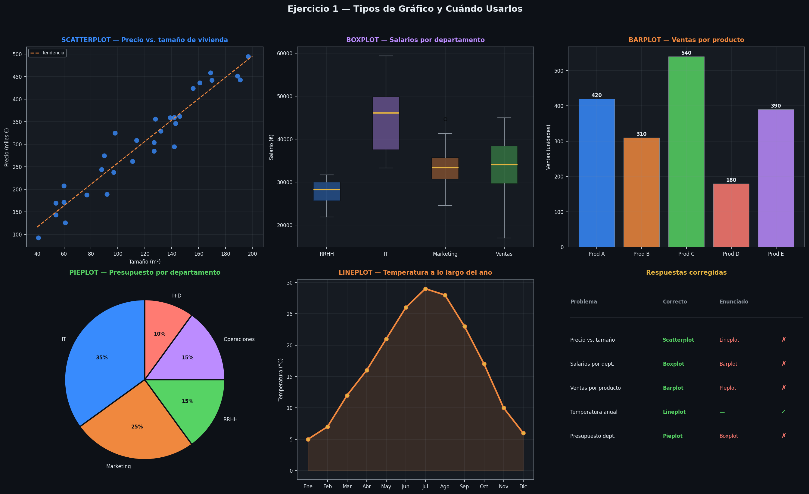
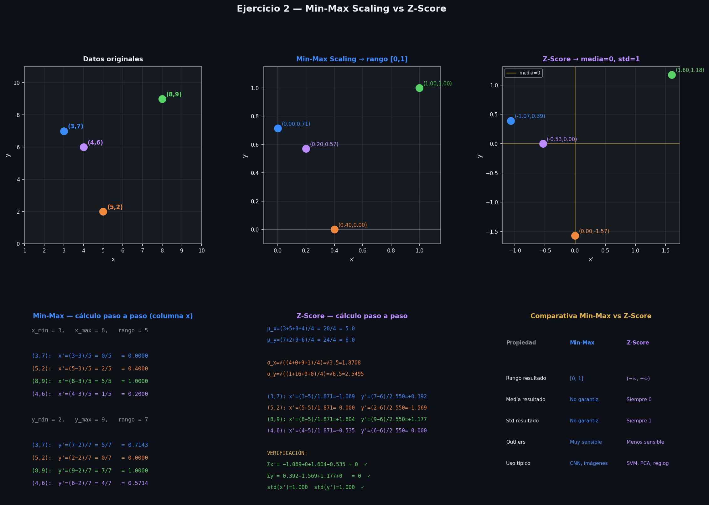
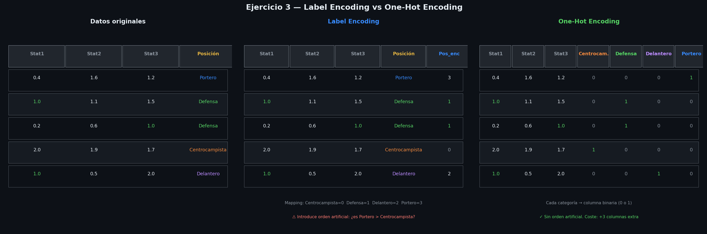
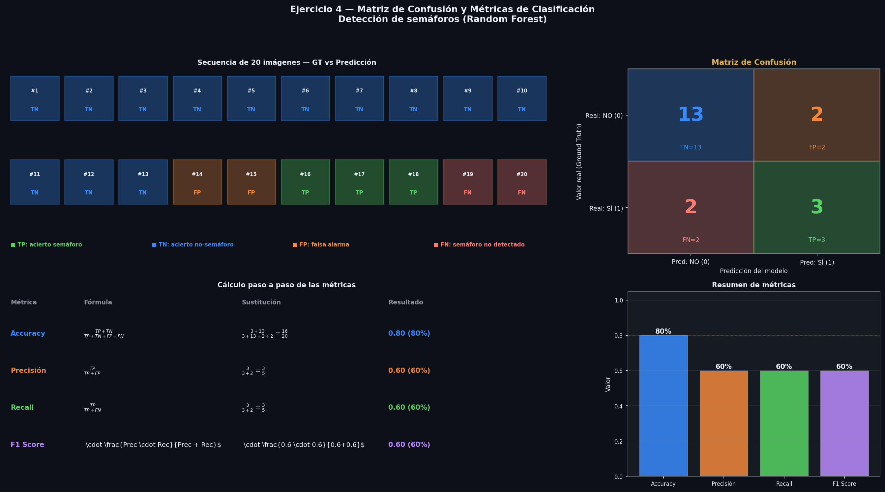

# Ejercicios resueltos: visualización, normalización, encoding, K-Means, overfitting y métricas

> Tema 3

---

## Ejercicio 1 — Tipos de Gráfico y Visualización de Datos

### Catálogo de gráficos

| Gráfico | Cuándo usarlo | Ejemplo típico |
|---------|--------------|----------------|
| **Scatterplot** | Relación/correlación entre dos variables continuas | Precio vs. tamaño de vivienda |
| **Boxplot** | Distribución, mediana, cuartiles y outliers por grupos | Salarios por departamento |
| **Barplot** | Comparar valores entre categorías discretas | Ventas por producto |
| **Pieplot** | Proporciones de un todo (partes de un 100%) | % presupuesto por departamento |
| **Lineplot** | Evolución de variable continua a lo largo del tiempo | Temperatura mensual |



---

### Resolución — Gráfico más útil por problema

#### 1. Relación entre precio y tamaño de viviendas → **Scatterplot**

El enunciado sugiere Lineplot, pero es incorrecto. Tenemos **dos variables continuas** sin orden temporal. El scatterplot permite:
- Ver si existe correlación (positiva, negativa, nula)
- Detectar outliers
- Evaluar si la relación es lineal → decidir si aplicar regresión lineal

El lineplot conecta puntos en orden, lo cual solo tiene sentido con un eje temporal.

---

#### 2. Comparación de salarios entre departamentos → **Boxplot**

El enunciado sugiere Barplot, pero el boxplot aporta mucho más. Un barplot solo muestra la media — oculta la distribución interna. El boxplot muestra por cada departamento:

- **Mediana** (línea central de la caja)
- **Q1 y Q3** (bordes de la caja = rango intercuartílico IQR)
- **Bigotes** = Q1 − 1.5·IQR y Q3 + 1.5·IQR
- **Outliers** (puntos fuera de los bigotes)

Esto revela brecha salarial, asimetrías y valores extremos que el barplot destruiría.

---

#### 3. Distribución de ventas por producto → **Barplot**

El enunciado sugiere Pieplot, pero con múltiples productos el pastel se vuelve ilegible. El barplot permite:
- Comparar valores **absolutos** entre categorías
- Ordenar de mayor a menor fácilmente
- Leer diferencias pequeñas con precisión (comparar longitudes es más fácil que comparar ángulos)

---

#### 4. Evolución de la temperatura a lo largo del año → **Lineplot** ✓

Correcto. La temperatura es una **serie temporal**: variable continua con eje X temporal ordenado. La línea conecta mediciones consecutivas mostrando tendencia, ciclos y estacionalidad.

---

#### 5. Proporción del presupuesto entre departamentos → **Pieplot**

El enunciado sugiere Boxplot, pero es incorrecto. El objetivo es mostrar **qué porcentaje del total** corresponde a cada departamento — exactamente para lo que está diseñado el pieplot.

El boxplot requiere una distribución de múltiples valores por grupo para calcular cuartiles. Un presupuesto por departamento es un **único valor por categoría**: no hay IQR, mediana ni outliers que calcular.

---

### Tabla resumen corregida

| Problema | Gráfico correcto | Gráfico del enunciado | ¿Coincide? |
|----------|-----------------|----------------------|-----------|
| Relación precio vs. tamaño de viviendas | **Scatterplot** | Lineplot | No |
| Comparación de salarios por departamento | **Boxplot** | Barplot | No |
| Distribución de ventas por producto | **Barplot** | Pieplot | No |
| Evolución de temperatura a lo largo del año | **Lineplot** | — | Sí |
| Proporción de presupuesto por departamento | **Pieplot** | Boxplot | No |

---

## Ejercicio 2 — Min-Max Scaling y Z-Score

**Dataset:** (3, 7), (5, 2), (8, 9), (4, 6)



---

## PARTE 1 — Min-Max Scaling

**Fórmula:**

$$x' = \frac{x - x_{min}}{x_{max} - x_{min}}$$

Transforma todos los valores al rango $[0, 1]$.

---

### Paso 1 — Calcular mínimos y máximos por columna

| | $x$ | $y$ |
|--|-----|-----|
| Valores | 3, 5, 8, 4 | 7, 2, 9, 6 |
| $x_{min}$ | **3** | **2** |
| $x_{max}$ | **8** | **9** |
| $x_{max} - x_{min}$ | **5** | **7** |

---

### Paso 2 — Aplicar la fórmula punto a punto

**Columna x** ($x_{min}=3$, $x_{max}-x_{min}=5$):

$$x'_{(3)} = \frac{3-3}{5} = \frac{0}{5} = \mathbf{0.0000}$$

$$x'_{(5)} = \frac{5-3}{5} = \frac{2}{5} = \mathbf{0.4000}$$

$$x'_{(8)} = \frac{8-3}{5} = \frac{5}{5} = \mathbf{1.0000}$$

$$x'_{(4)} = \frac{4-3}{5} = \frac{1}{5} = \mathbf{0.2000}$$

**Columna y** ($y_{min}=2$, $y_{max}-y_{min}=7$):

$$y'_{(7)} = \frac{7-2}{7} = \frac{5}{7} = \mathbf{0.7143}$$

$$y'_{(2)} = \frac{2-2}{7} = \frac{0}{7} = \mathbf{0.0000}$$

$$y'_{(9)} = \frac{9-2}{7} = \frac{7}{7} = \mathbf{1.0000}$$

$$y'_{(6)} = \frac{6-2}{7} = \frac{4}{7} = \mathbf{0.5714}$$

---

### Resultado Min-Max

| Punto original | $x'$ | $y'$ |
|---------------|------|------|
| (3, 7) | 0.0000 | 0.7143 |
| (5, 2) | 0.4000 | 0.0000 |
| (8, 9) | 1.0000 | 1.0000 |
| (4, 6) | 0.2000 | 0.5714 |

> El valor mínimo original → 0, el máximo original → 1. Todos los valores quedan en $[0, 1]$.

---

## PARTE 2 — Z-Score (Estandarización)

**Fórmula:**

$$x' = \frac{x - \mu}{\sigma}$$

Transforma los datos para que tengan **media = 0** y **desviación estándar = 1**.

---

### Paso 1 — Calcular la media $\mu$ de cada columna

$$\mu_x = \frac{3+5+8+4}{4} = \frac{20}{4} = \mathbf{5.0}$$

$$\mu_y = \frac{7+2+9+6}{4} = \frac{24}{4} = \mathbf{6.0}$$

---

### Paso 2 — Calcular la desviación estándar $\sigma$

$$\sigma = \sqrt{\frac{\sum_{i=1}^{n}(x_i - \mu)^2}{n}}$$

**Para x:**

$$\sigma_x = \sqrt{\frac{(3-5)^2+(5-5)^2+(8-5)^2+(4-5)^2}{4}} = \sqrt{\frac{4+0+9+1}{4}} = \sqrt{\frac{14}{4}} = \sqrt{3.5} = \mathbf{1.8708}$$

| $x_i$ | $x_i - \mu_x$ | $(x_i - \mu_x)^2$ |
|--------|--------------|-------------------|
| 3 | −2 | 4 |
| 5 | 0 | 0 |
| 8 | +3 | 9 |
| 4 | −1 | 1 |
| **Σ** | | **14** |

**Para y:**

$$\sigma_y = \sqrt{\frac{(7-6)^2+(2-6)^2+(9-6)^2+(6-6)^2}{4}} = \sqrt{\frac{1+16+9+0}{4}} = \sqrt{\frac{26}{4}} = \sqrt{6.5} = \mathbf{2.5495}$$

| $y_i$ | $y_i - \mu_y$ | $(y_i - \mu_y)^2$ |
|--------|--------------|-------------------|
| 7 | +1 | 1 |
| 2 | −4 | 16 |
| 9 | +3 | 9 |
| 6 | 0 | 0 |
| **Σ** | | **26** |

---

### Paso 3 — Aplicar la fórmula punto a punto

**Columna x** ($\mu_x = 5$, $\sigma_x = 1.8708$):

$$x'_{(3)} = \frac{3-5}{1.8708} = \frac{-2}{1.8708} = \mathbf{-1.0690}$$

$$x'_{(5)} = \frac{5-5}{1.8708} = \frac{0}{1.8708} = \mathbf{0.0000}$$

$$x'_{(8)} = \frac{8-5}{1.8708} = \frac{+3}{1.8708} = \mathbf{+1.6036}$$

$$x'_{(4)} = \frac{4-5}{1.8708} = \frac{-1}{1.8708} = \mathbf{-0.5345}$$

**Columna y** ($\mu_y = 6$, $\sigma_y = 2.5495$):

$$y'_{(7)} = \frac{7-6}{2.5495} = \frac{+1}{2.5495} = \mathbf{+0.3922}$$

$$y'_{(2)} = \frac{2-6}{2.5495} = \frac{-4}{2.5495} = \mathbf{-1.5689}$$

$$y'_{(9)} = \frac{9-6}{2.5495} = \frac{+3}{2.5495} = \mathbf{+1.1767}$$

$$y'_{(6)} = \frac{6-6}{2.5495} = \frac{0}{2.5495} = \mathbf{0.0000}$$

---

### Resultado Z-Score

| Punto original | $x'$ | $y'$ |
|---------------|------|------|
| (3, 7) | −1.0690 | +0.3922 |
| (5, 2) | 0.0000 | −1.5689 |
| (8, 9) | +1.6036 | +1.1767 |
| (4, 6) | −0.5345 | 0.0000 |

---

## PARTE 3 — Verificación Z-Score

### Verificación de media = 0

$$\mu_{x'} = \frac{(-1.0690) + 0.0000 + 1.6036 + (-0.5345)}{4} = \frac{0.0001}{4} \approx \mathbf{0} \checkmark$$

$$\mu_{y'} = \frac{0.3922 + (-1.5689) + 1.1767 + 0.0000}{4} = \frac{0.0000}{4} = \mathbf{0} \checkmark$$

### Verificación de desviación estándar = 1

$$\sigma_{x'} = \sqrt{\frac{(-1.0690)^2 + (0.0000)^2 + (1.6036)^2 + (-0.5345)^2}{4}} = \sqrt{\frac{1.1428 + 0 + 2.5715 + 0.2857}{4}} = \sqrt{1.0000} = \mathbf{1} \checkmark$$

$$\sigma_{y'} = \sqrt{\frac{(0.3922)^2 + (-1.5689)^2 + (1.1767)^2 + (0.0000)^2}{4}} = \sqrt{\frac{0.1538 + 2.4614 + 1.3846 + 0}{4}} = \sqrt{1.0000} = \mathbf{1} \checkmark$$

---

## Comparativa final

| | **Min-Max** | **Z-Score** |
|--|-------------|-------------|
| **Rango resultante** | Siempre $[0,\,1]$ | $(-\infty,\,+\infty)$, centrado en 0 |
| **Media resultante** | No garantizada | Siempre **0** |
| **Desv. estándar** | No garantizada | Siempre **1** |
| **Sensible a outliers** | Sí — un outlier extremo comprime todo | Menos — outliers quedan lejos de 0 |
| **Cuándo usar** | Rango fijo necesario (imágenes, redes neuronales) | Algoritmos que asumen distribución normal (SVM, PCA, regresión logística) |

---

## Ejercicio 3 — Label Encoding y One-Hot Encoding

**Dataset de entrada** (Stat1, Stat2, Stat3 son estadísticas numéricas avanzadas):

| Stat1 | Stat2 | Stat3 | Posición |
|-------|-------|-------|----------|
| 0.4 | 1.6 | 1.2 | Portero |
| 1.0 | 1.1 | 1.5 | Defensa |
| 0.2 | 0.6 | 1.0 | Defensa |
| 2.0 | 1.9 | 1.7 | Centrocampista |
| 1.0 | 0.5 | 2.0 | Delantero |

La columna **Posición** es categórica con 4 valores posibles: Portero, Defensa, Centrocampista, Delantero.
Los algoritmos de ML no operan sobre texto, por lo que hay que convertirla a formato numérico.



---

## PARTE 1 — Label Encoding

**Concepto:** asignar un número entero a cada categoría.

**Mapping** (orden alfabético, convención estándar):

| Categoría | Código |
|-----------|--------|
| Centrocampista | **0** |
| Defensa | **1** |
| Delantero | **2** |
| Portero | **3** |

**Aplicación:**

| Stat1 | Stat2 | Stat3 | Posición | **Pos_enc** |
|-------|-------|-------|----------|-------------|
| 0.4 | 1.6 | 1.2 | Portero | **3** |
| 1.0 | 1.1 | 1.5 | Defensa | **1** |
| 0.2 | 0.6 | 1.0 | Defensa | **1** |
| 2.0 | 1.9 | 1.7 | Centrocampista | **0** |
| 1.0 | 0.5 | 2.0 | Delantero | **2** |

**Ventajas:**
- Simple, no añade columnas
- Eficiente en memoria

**Problema crítico:**
El número introduce un **orden artificial** que no existe en la realidad. El modelo puede interpretar que Portero (3) > Delantero (2) > Defensa (1) > Centrocampista (0), como si hubiera una jerarquía numérica entre posiciones — lo cual es incorrecto.

> Label Encoding es adecuado solo para variables **ordinales** (ej: Nivel = Bajo/Medio/Alto, donde sí hay un orden real).

---

## PARTE 2 — One-Hot Encoding

**Concepto:** crear una columna binaria (0 o 1) por cada categoría. Solo una columna vale 1 por fila.

Para 4 categorías → se añaden **4 columnas nuevas**, eliminando la columna original.

**Aplicación:**

| Stat1 | Stat2 | Stat3 | Pos_Centrocampista | Pos_Defensa | Pos_Delantero | Pos_Portero |
|-------|-------|-------|--------------------|-------------|---------------|-------------|
| 0.4 | 1.6 | 1.2 | 0 | 0 | 0 | **1** |
| 1.0 | 1.1 | 1.5 | 0 | **1** | 0 | 0 |
| 0.2 | 0.6 | 1.0 | 0 | **1** | 0 | 0 |
| 2.0 | 1.9 | 1.7 | **1** | 0 | 0 | 0 |
| 1.0 | 0.5 | 2.0 | 0 | 0 | **1** | 0 |

**Propiedad clave:** en cada fila exactamente **un 1** y el resto **ceros**. La suma de las 4 columnas OHE siempre es 1.

**Ventajas:**
- No introduce ningún orden artificial entre categorías
- El modelo trata cada posición como independiente

**Inconvenientes:**
- Añade $k-1$ columnas extra ($k$ = número de categorías) → problema de **alta dimensionalidad** si hay muchas categorías
- Riesgo de **multicolinealidad**: si se incluyen las $k$ columnas, una es linealmente dependiente de las demás (dummy variable trap). La solución es eliminar una columna (usar $k-1$)

---

## Comparativa final

| | **Label Encoding** | **One-Hot Encoding** |
|--|-------------------|---------------------|
| **Columnas resultantes** | +1 (sustituye la original) | +k (una por categoría) |
| **Orden artificial** | Sí — introduce jerarquía numérica | No — cada categoría es independiente |
| **Cuándo usar** | Variables **ordinales** (Bajo/Medio/Alto) | Variables **nominales** sin orden (posiciones, colores, países) |
| **Riesgo** | Sesga el modelo con orden falso | Alta dimensionalidad si k es grande |
| **Aplicación a este ejercicio** | Incorrecto — las posiciones no tienen orden | **Correcto** — Portero no es > ni < que Defensa |

---

## Ejercicio 6 — Análisis de parámetros KMeans (sklearn)

### La clase `KMeans` en `sklearn.cluster`

`KMeans` implementa el algoritmo de clustering K-Means: agrupa los datos en $K$ clusters minimizando la **inercia** (suma de distancias cuadráticas de cada punto a su centroide más cercano):

$$J = \sum_{k=1}^{K}\sum_{x_i \in C_k} \|x_i - \mu_k\|^2$$

```python
kmeans = KMeans(n_clusters=3, init='random', n_init=10, max_iter=300, tol=1e-4, random_state=42)
```

---

### Análisis parámetro a parámetro

#### `n_clusters=3`

Define el número de clusters $K$ en los que se dividirán los datos. Con valor 3, el algoritmo buscará **3 grupos**, creando 3 centroides y asignando cada punto al más cercano. Es el parámetro más importante de K-Means y debe elegirse a priori (habitualmente con el método del codo o el índice de Silhouette).

#### `init='random'`

Define cómo se inicializan los centroides al inicio del algoritmo.

| Valor | Comportamiento |
|-------|---------------|
| `'random'` | Selecciona $K$ puntos aleatorios del dataset como centroides iniciales |
| `'k-means++'` | El primer centroide es aleatorio; los siguientes se eligen con probabilidad proporcional a su distancia al centroide más cercano ya elegido → converge más rápido y con mejor resultado |

Con `'random'` la inicialización es totalmente aleatoria, lo que puede llevar a convergencias subóptimas. Por eso se combina con `n_init > 1`.

#### `n_init=10`

Número de veces que se ejecuta el algoritmo completo con semillas de centroides distintas. Con valor 10, el algoritmo se ejecuta **10 veces desde cero** y se queda con la solución de **menor inercia final**. Compensa la aleatoriedad de `init='random'`: aunque una ejecución converja a un mínimo local, con 10 intentos es probable encontrar una buena solución.

#### `max_iter=300`

Número máximo de iteraciones (asignación + recalculado de centroides) por ejecución. Si el algoritmo no converge antes de 300 iteraciones, se detiene igualmente. Actúa como salvaguarda. En la práctica K-Means converge en pocas decenas de iteraciones.

#### `tol=1e-4`

Tolerancia de convergencia. El algoritmo se detiene cuando el desplazamiento de los centroides entre dos iteraciones consecutivas es menor que este valor:

$$\|\mu_k^{(t)} - \mu_k^{(t-1)}\| < \text{tol} \quad \forall k$$

Con $10^{-4}$ el criterio es estricto: los centroides deben estar prácticamente inmóviles. Valores más altos detienen antes el algoritmo (más rápido, menos preciso).

#### `random_state=42`

Fija la semilla del generador de números aleatorios. Garantiza **reproducibilidad**: ejecutando el mismo código con los mismos datos siempre se obtiene exactamente el mismo resultado. El valor 42 no tiene significado especial, es una convención popular en la comunidad de ML.

---

### Descripción completa del modelo

Se implementa un K-Means con **3 clusters**, inicializado con centroides **aleatorios**. Para mitigar el riesgo de converger en un mínimo local, el algoritmo se ejecuta **10 veces independientes** con distintas semillas, seleccionando la solución de menor inercia. Cada ejecución permite un máximo de **300 iteraciones** y se considera convergida cuando los centroides se desplazan menos de $10^{-4}$ entre pasos. La semilla `random_state=42` garantiza la reproducibilidad del experimento.

---

### Tabla resumen

| Parámetro | Valor | Efecto |
|-----------|-------|--------|
| `n_clusters` | 3 | Buscar 3 grupos en los datos |
| `init` | `'random'` | Centroides iniciales aleatorios (vs. `'k-means++'` más inteligente) |
| `n_init` | 10 | 10 ejecuciones independientes → quedarse con la mejor |
| `max_iter` | 300 | Máximo 300 iteraciones por ejecución |
| `tol` | 1e-4 | Parar cuando los centroides apenas se mueven ($< 10^{-4}$) |
| `random_state` | 42 | Semilla fija → resultados reproducibles |

---

## Ejercicio 5 — Overfitting vs Underfitting

### Marco teórico

| | **Overfitting** | **Underfitting** |
|--|-----------------|-----------------|
| **Qué ocurre** | Memoriza el training set, no generaliza | No aprende ni siquiera el training set |
| **Train error** | Muy bajo | Alto |
| **Test error** | Muy alto | Alto |
| **Causa** | Modelo demasiado complejo, datos sesgados o poco diversos | Modelo demasiado simple, pocas features, poco entrenamiento |
| **Solución** | Más datos diversos, regularización, dropout | Modelo más complejo, más features, más épocas |

> **Regla rápida:** si el modelo funciona bien en training pero falla en test → **overfitting**. Si ya falla en training → **underfitting**.

---

### Resolución

#### Caso 1 — Gatos y perros blancos, falla con otros colores → **OVERFITTING**

Buen rendimiento en training, falla con datos nuevos. El dataset estaba **sesgado**: solo imágenes blancas, así que el modelo memorizó el color como característica en vez de aprender la forma general de un gato o perro. Al ver un gato naranja, el patrón no aplica.

#### Caso 2 — Precio de vivienda, resultados bajos ya en training → **UNDERFITTING**

La clave es que **ya en el training set los resultados son bajos**. El modelo no es capaz de ajustarse ni a los datos con los que fue entrenado: demasiado simple para capturar la relación entre m², ciudad y precio. No es problema de generalización, es problema de capacidad del modelo.

#### Caso 3 — Modelo de fraude que funciona en un banco pero no en otro → **OVERFITTING**

El modelo aprendió los **patrones específicos del banco original** (distribución de transacciones, comportamiento de sus clientes, tipos de fraude). Al aplicarlo a un banco diferente, los patrones son distintos y no generaliza. Overfitting al dominio de entrenamiento.

#### Caso 4 — Reconocimiento de voz entrenado con mi voz, falla con mi hermana → **OVERFITTING**

Perfecto rendimiento sobre los datos de entrenamiento (mi voz), falla completamente con voz nueva. El dataset era de una única fuente, por lo que el modelo memorizó características vocales específicas en lugar de aprender el habla en general.

---

### Tabla resumen

| Problema | Overfitting | Underfitting | Motivo |
|----------|:-----------:|:------------:|--------|
| Gatos/perros blancos, falla con otros colores | **X** | | Datos sesgados → memoriza color, no generaliza |
| Precio vivienda, ya falla en training | | **X** | Modelo demasiado simple para capturar la relación |
| Modelo de fraude, no funciona en nuevo banco | **X** | | Sobreajuste al dominio del banco original |
| Reconocimiento de voz solo con mi voz | **X** | | Entrenado con una sola fuente → no generaliza |

---

## Ejercicio 4 — Matriz de Confusión y Métricas de Clasificación

**Problema:** Clasificación binaria — ¿Contiene la imagen un semáforo?

- **Clase positiva (1):** contiene semáforo
- **Clase negativa (0):** no contiene semáforo

### Paso 1 — Reconstruir las predicciones imagen a imagen

| Imagen | Ground Truth | Predicción | Resultado |
|--------|-------------|------------|-----------|
| 1–13 | NO (0) | NO (0) | **TN** × 13 |
| 14–15 | NO (0) | SÍ (1) | **FP** × 2 |
| 16–18 | SÍ (1) | SÍ (1) | **TP** × 3 |
| 19–20 | SÍ (1) | NO (0) | **FN** × 2 |

- Las 15 primeras son realmente NO semáforo → el modelo clasifica 13 como NO (**TN**) y 2 como SÍ (**FP**)
- Las 5 últimas son realmente SÍ semáforo → el modelo clasifica 3 como SÍ (**TP**) y 2 como NO (**FN**)

$$TP = 3 \qquad TN = 13 \qquad FP = 2 \qquad FN = 2$$



---

### Paso 2 — Matriz de Confusión

|  | **Predicho: NO (0)** | **Predicho: SÍ (1)** |
|--|----------------------|----------------------|
| **Real: NO (0)** | TN = **13** | FP = **2** |
| **Real: SÍ (1)** | FN = **2** | TP = **3** |

**Interpretación de cada celda:**

| Término | Significado en este problema |
|---------|------------------------------|
| **TP** (True Positive) | Imagen con semáforo → correctamente detectada como semáforo |
| **TN** (True Negative) | Imagen sin semáforo → correctamente descartada |
| **FP** (False Positive) | Imagen sin semáforo → detectada erróneamente como semáforo (falsa alarma) |
| **FN** (False Negative) | Imagen con semáforo → no detectada (semáforo perdido — el más peligroso) |

---

### Paso 3 — Cálculo de métricas

#### Accuracy (Exactitud)

$$\text{Accuracy} = \frac{TP + TN}{TP + TN + FP + FN} = \frac{3 + 13}{3 + 13 + 2 + 2} = \frac{16}{20} = \mathbf{0.80}$$

El modelo acierta el **80%** de las imágenes.

---

#### Precisión (Precision)

$$\text{Precision} = \frac{TP}{TP + FP} = \frac{3}{3 + 2} = \frac{3}{5} = \mathbf{0.60}$$

De todas las imágenes que el modelo clasifica como semáforo, el **60%** realmente lo son.
Mide la fiabilidad de las alertas positivas.

---

#### Recall (Sensibilidad / Tasa de detección)

$$\text{Recall} = \frac{TP}{TP + FN} = \frac{3}{3 + 2} = \frac{3}{5} = \mathbf{0.60}$$

De todos los semáforos reales, el modelo detecta el **60%**.
Mide cuántos positivos reales captura el modelo.

---

#### F1 Score

$$F1 = 2 \cdot \frac{\text{Precision} \cdot \text{Recall}}{\text{Precision} + \text{Recall}} = 2 \cdot \frac{0.60 \cdot 0.60}{0.60 + 0.60} = 2 \cdot \frac{0.36}{1.20} = \mathbf{0.60}$$

Media armónica entre Precision y Recall. En este caso coinciden, por lo que F1 = ambas.

---

### Resumen de resultados

| Métrica | Fórmula | Resultado |
|---------|---------|-----------|
| **TP** | Semáforos correctamente detectados | **3** |
| **TN** | No-semáforos correctamente descartados | **13** |
| **FP** | Falsas alarmas (no-semáforo → semáforo) | **2** |
| **FN** | Semáforos no detectados | **2** |
| **Accuracy** | (TP+TN)/20 | **0.80 (80%)** |
| **Precision** | TP/(TP+FP) | **0.60 (60%)** |
| **Recall** | TP/(TP+FN) | **0.60 (60%)** |
| **F1 Score** | 2·P·R/(P+R) | **0.60 (60%)** |

### Interpretación

El **Accuracy del 80%** parece bueno, pero está inflado por los 13 TN (hay muchas más imágenes sin semáforo). Las métricas relevantes para el problema real son:

- **Recall = 0.60** es bajo en un sistema de seguridad: el modelo falla en detectar 2 de cada 5 semáforos reales (FN) → en conducción autónoma esto sería crítico.
- Si la prioridad fuera no perder ningún semáforo, habría que optimizar el **Recall** aunque baje la Precision (aceptar más falsas alarmas).
- Si la prioridad fuera no generar falsas alarmas, habría que optimizar la **Precision**.
