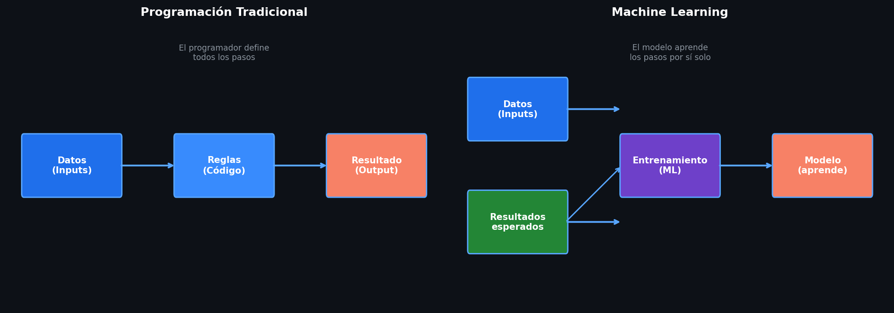
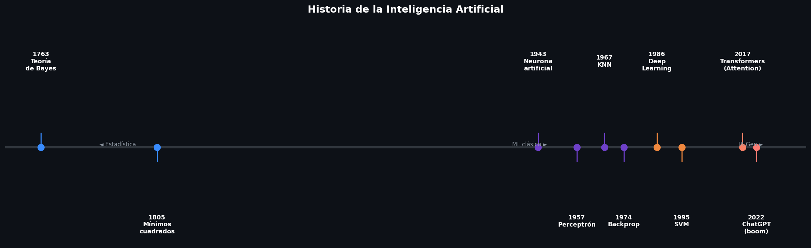
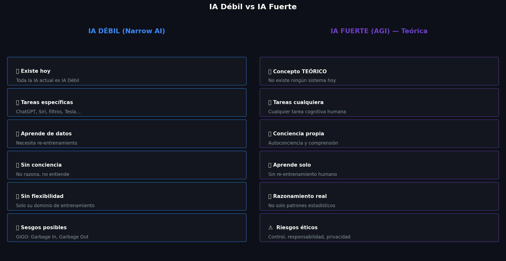

# Resumen: caracterización de la IA débil y fuerte

> Tema 1, RA1
> Basado en IABD_MP2_T01.pdf
> Visualizaciones generadas por: [visualizaciones_ia_debil_y_fuerte.ipynb](visual/RA1/visualizaciones_ia_debil_y_fuerte.ipynb)

---

## 1. ¿Qué es la Inteligencia Artificial?

**Definición:** Conjunto de capacidades cognoscitivas e intelectuales expresadas por sistemas informáticos o combinaciones de algoritmos cuyo propósito es la creación de máquinas que imiten la inteligencia humana para realizar tareas, y que pueden mejorar conforme recopilen información.

En términos simples: **modelos matemáticos avanzados** que aprenden patrones a partir de datos para realizar tareas que normalmente requieren inteligencia humana.

> **Clave conceptual:** La IA es la solución a un problema que **no sabemos expresar en instrucciones**. Ejemplo: podemos programar multiplicaciones paso a paso, pero NO podemos programar "cómo reconocer un perro en una imagen" — ahí entra la IA.

**Diferencia entre programación tradicional e IA:**

| Enfoque                   | Proceso                                                                       |
| ------------------------- | ----------------------------------------------------------------------------- |
| Programación tradicional | Datos + Reglas → Resultado                                                   |
| Machine Learning          | Datos + Resultados esperados →**Modelo** que predice nuevos resultados |

**La IA NO es:** chatbots estáticos, robots autónomos basados en reglas, sistemas expertos con reglas fijas, modelos estadísticos clásicos.

---

## 2. Breve Historia de la IA

| Fecha       | Hito                                                                 |
| ----------- | -------------------------------------------------------------------- |
| Siglo XVIII | Teoría de Bayes — inferencia probabilística                       |
| Siglo XIX   | Método de mínimos cuadrados (Legendre) — base de la regresión    |
| 1943        | Primer modelo matemático de neurona artificial (McCulloch & Pitts)  |
| 1957        | Perceptrón — primera estructura de red neuronal (Rosenblatt)       |
| 1967        | Algoritmo K-Nearest Neighbors                                        |
| 1974        | Algoritmo de backpropagation                                         |
| 1986        | Geoff Hinton acuña el término "deep learning"                      |
| 1995        | Support Vector Machines (SVM)                                        |
| 2017        | Paper "Attention is all you need" — base de los Transformers y LLMs |
| Nov 2022    | Lanzamiento de ChatGPT — boom de la IA Generativa                   |

---

## 3. IA Débil (Narrow AI)

### Definición

Sistemas de IA **especializados y destinados a realizar tareas específicas**. **Toda la IA que existe hoy en día es IA Débil.**

### Características principales

| Característica                                | Descripción                                                |
| ---------------------------------------------- | ----------------------------------------------------------- |
| **Especialización en tareas concretas** | Solo puede hacer aquello para lo que fue entrenada          |
| **Gran dependencia de los datos**        | La calidad y cantidad de datos determina su eficacia        |
| **Necesidad de actualización**          | Para nuevos casos de uso, hay que re-entrenar               |
| **Uso de métricas de precisión**       | Se mide su rendimiento con datos nuevos                     |
| **Falta de conciencia**                  | No razona, no tiene emociones, no entiende contexto general |

### Ejemplos reales

- **IA Generativa:** ChatGPT (texto), DALL-E (imagen), Sora (video)
- **Asistentes virtuales:** Siri, Alexa, Google Assistant
- **Sistemas de recomendación:** Netflix, Instagram, Amazon
- **Reconocimiento de voz:** Dictado de texto, transcripción
- **Filtros de spam:** Gmail
- **Reconocimiento facial:** Sistemas de seguridad
- **Vehículos autónomos:** Tesla
- **Chatbots:** Atención al cliente en bancos y tiendas
- **Traducción automática:** Google Translate
- **Diagnóstico médico:** Análisis de imágenes médicas
- **Análisis de sentimiento:** Redes sociales y reseñas

### Ventajas

1. **Resolución de tareas complejas** — resuelve lo que no se puede expresar en instrucciones
2. **Automatización** — opera sin descanso, aumenta eficiencia y productividad
3. **Precisión y velocidad** — supera al humano en velocidad de procesamiento en tareas específicas
4. **Personalización** — experiencias adaptadas al usuario

### Inconvenientes

1. **Falta de flexibilidad** — no se adapta a nuevas situaciones sin reprogramación
2. **Dependencia de datos / sesgos** — datos sesgados → modelo sesgado (GIGO: Garbage In, Garbage Out)
3. **Privacidad y seguridad** — uso de grandes volúmenes de datos personales
4. **Impacto en el empleo** — puede sustituir tareas repetitivas
5. **Falta de transparencia (caja negra)** — difícil explicar sus decisiones
6. **Costes de mantenimiento** — infraestructura, actualizaciones, nuevos datos

### Usos y posibilidades futuras

- Personalización cada vez más precisa
- Integración en realidad aumentada / virtual
- Aceleración de la innovación científica y médica
- Automatización de tareas cada vez más complejas
- Interacción humano-máquina más natural (sin necesidad de ser experto técnico)

---

## 4. IA Fuerte (Artificial General Intelligence — AGI)

### Definición

**Concepto TEÓRICO** — no existe ningún sistema de IA Fuerte a día de hoy.

Busca emular la inteligencia humana **en su totalidad**: razonar, aprender, tener autoconciencia y realizar **cualquier** tarea que requiera inteligencia humana.

### Características requeridas (hipotéticas)

| Característica                       | Descripción                                            |
| ------------------------------------- | ------------------------------------------------------- |
| **Conciencia de sí misma**     | Comprensión profunda de su propia existencia y entorno |
| **Aprendizaje y adaptación**   | Aprender de experiencias pasadas de manera autónoma    |
| **Razonamiento lógico**        | Razonamiento complejo similar al humano                 |
| **Resolución de problemas**    | En cualquier contexto, no solo en uno específico       |
| **Planificación y previsión** | Tomar decisiones estratégicas a largo plazo            |

> **Nota:** No es necesario que tenga sentimientos, instinto de supervivencia o necesidad de relación social para ser considerada IA Fuerte. Solo con los requisitos anteriores ya sería suficiente.

### Por qué ChatGPT NO es IA Fuerte

| Característica IA Fuerte   | Por qué ChatGPT no la cumple                                                          |
| --------------------------- | -------------------------------------------------------------------------------------- |
| Conciencia de sí misma     | Procesa texto por patrones estadísticos, sin autoconciencia ni emociones              |
| Aprendizaje y adaptación   | Una vez entrenado, no modifica su conocimiento en tiempo real sin intervención humana |
| Razonamiento lógico        | Genera respuestas por probabilidades, no por deducción lógica real                   |
| Resolución de problemas    | No identifica ni resuelve problemas de manera autónoma                                |
| Planificación y previsión | No establece objetivos ni anticipa consecuencias a largo plazo                         |

### Posibles riesgos (éticos)

- Pérdida de control sobre sus decisiones
- Responsabilidad difusa si causa daño
- Desempleo masivo
- Vigilancia masiva y pérdida de privacidad
- Desalineación de objetivos con los humanos
- Dependencia tecnológica extrema
- Manipulación de información a gran escala

### Posibles aplicaciones futuras (hipotéticas)

- Medicina: diagnóstico temprano y tratamientos personalizados
- Automatización industrial completa
- Asistentes virtuales que anticipan necesidades
- Finanzas: predicción de mercados
- Educación totalmente personalizada
- Investigación científica acelerada
- Gestión óptima de recursos naturales

---

## 5. Tabla Comparativa: IA Débil vs IA Fuerte

|                                  | IA Débil                           | IA Fuerte                 |
| -------------------------------- | ----------------------------------- | ------------------------- |
| **¿Existe hoy?**          | Sí — toda la IA actual            | No — concepto teórico   |
| **También llamada**       | IA Estrecha / Narrow AI             | IA General / AGI          |
| **Alcance**                | Tareas específicas y definidas     | Cualquier tarea cognitiva |
| **Conciencia**             | No                                  | Sí (hipotéticamente)    |
| **Aprende autónomamente** | No (necesita re-entrenamiento)      | Sí (hipotéticamente)    |
| **Razona**                 | No — aplica patrones estadísticos | Sí (hipotéticamente)    |
| **Ejemplos**               | ChatGPT, Siri, filtro spam          | Ninguno todavía          |

---

## 6. Conceptos Clave para el Examen

- **IA = modelos matemáticos** que aprenden patrones, no "cerebros que piensan"
- **Toda la IA actual es IA Débil**, incluyendo ChatGPT
- La IA resuelve problemas que **no podemos expresar en instrucciones**
- **IA Fuerte** = teórica, ningún sistema la cumple hoy
- La IA aprende por **iteraciones de entrenamiento** (como un niño al que se le muestran ejemplos)
- Los modelos actuales **no tienen autoconciencia, no razonan, no planifican**
- Los sesgos en los datos de entrada producen **sesgos en el modelo** — GIGO (Garbage In, Garbage Out)
- La IA no surgió de la nada: es evolución de modelos probabilísticos de siglos anteriores

### Preguntas tipo test frecuentes (con respuesta correcta marcada con ✓)

**¿Cuál de las siguientes afirmaciones es correcta?**

- ✓ La IA Débil está diseñada para realizar tareas específicas.
- ✗ La IA Débil puede realizar cualquier tarea cognitiva que un ser humano pueda.

**¿Cuál es una característica de la IA Fuerte?**

- ✓ Tiene conciencia y entendimiento general.
- ✗ Solo puede realizar tareas específicas.

**¿Cuál describe mejor la IA Débil?**

- ✓ Está diseñada para realizar tareas específicas y limitadas.
- ✗ Tiene conciencia y puede desarrollar autoconciencia.
