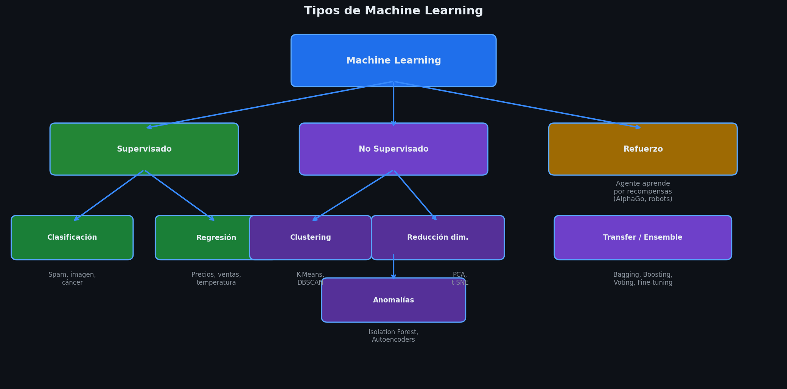
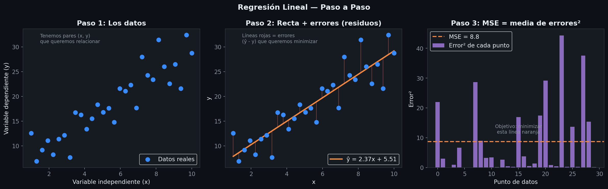
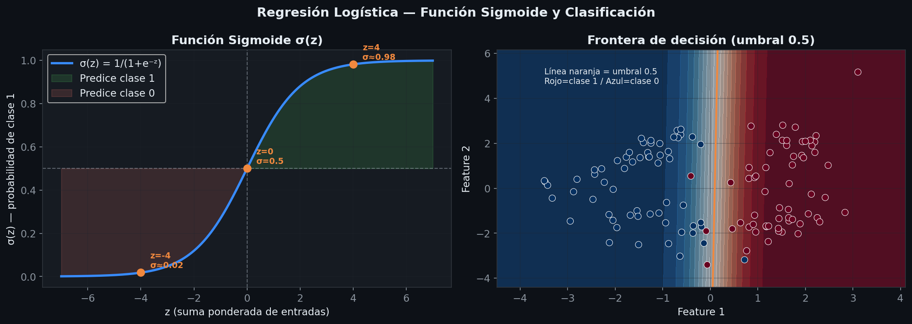
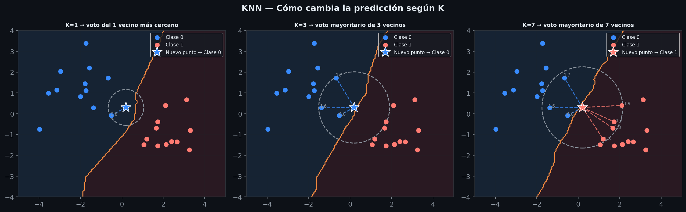
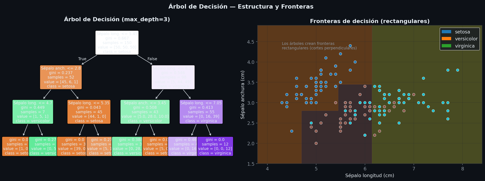
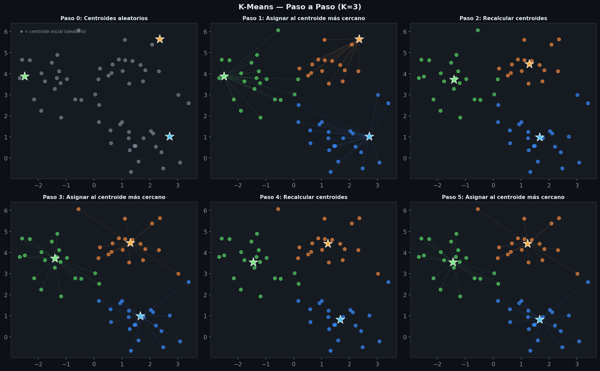
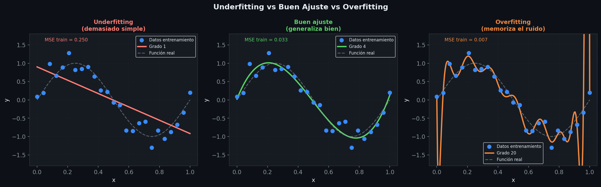

# Resumen: tipos y algoritmos de Machine Learning

> Tema 2, RA2 y RA4
> Basado en Clase 2, Clase 3 y apuntes IABD_MP2_T02
> Visualizaciones generadas por: [visualizaciones_machine_learning.ipynb](visual/RA2_RA4/visualizaciones_machine_learning.ipynb)

---

## 1. Definición de Machine Learning

**Machine Learning (Aprendizaje Automático):** Subdisciplina de la IA que desarrolla algoritmos y modelos que permiten a las máquinas **aprender y hacer predicciones** basadas en datos, sin ser programadas explícitamente para cada tarea.

**No son ML:** Chatbots estáticos, sistemas expertos, robots autónomos basados en reglas, modelos estadísticos clásicos.

**Jerarquía:**
```
IA → Machine Learning → Deep Learning (redes neuronales) → IA Generativa
```

---

## 2. Tipos de Aprendizaje Automático



### 2.1 Aprendizaje Inductivo (Supervisado y No Supervisado)

Parte de casos **específicos** para llegar a patrones **generales**. Características:
- Observación empírica
- De lo particular a lo general
- Flexible (modifica con nuevas observaciones)
- Tentativo (puede cambiar con nuevas evidencias)
- Probabilístico

### 2.2 Aprendizaje Supervisado

- El modelo se entrena con datos **etiquetados** (entrada + resultado esperado)
- Predice la clase o valor + una **probabilidad asociada** a cada predicción
- Problemas: **Clasificación** y **Regresión**

**Proceso de entrenamiento (4 pasos):**

| Paso | Descripción |
|------|-------------|
| 1. Selección y etiquetado de datos | Calidad, equilibrio, volumen, consistencia. Se dividen en **train / validation / test** |
| 2. Selección del modelo | Según tipo de problema y experiencia. Se prueban varios modelos/configuraciones |
| 3. Entrenamiento y evaluación | Forward pass → función de pérdida → backward pass. Iteraciones automáticas hasta convergencia |
| 4. Despliegue y monitorización | Inferencia sobre nuevos datos. Optimización y MLOps para mantener calidad |

**Iteración de entrenamiento:**
1. **Forward pass:** el modelo predice para el conjunto de train
2. **Función de pérdida:** mide cuánto se equivoca
3. **Backward pass:** ajusta parámetros para corregir errores
4. Cada cierto número de iteraciones se evalúa sobre **validation set**

### 2.3 Aprendizaje No Supervisado

- Datos **sin etiquetar** — el modelo encuentra patrones ocultos por sí solo
- No hay función de pérdida, sino **métricas de observación** (insights)
- Solo un conjunto de datos (no se divide en train/val/test)
- Requiere **normalización previa** de datos
- Problemas: **Clustering** y **Reducción de dimensionalidad**

### 2.4 Aprendizaje Semi-Supervisado

- Combina datos etiquetados y no etiquetados
- Útil cuando etiquetar es costoso

**Variantes:**
- **Active Learning:** el propio modelo selecciona qué datos deben etiquetarse (prioriza donde tiene más dudas)
- **Auto-supervisado:** el modelo genera las propias etiquetas para re-entrenarse (riesgo de baja calidad)

### 2.5 Aprendizaje por Refuerzo (Reinforcement Learning)

- Un **agente** aprende por **prueba y error** en un entorno dinámico
- Recibe **recompensas** (+) o **penalizaciones** (−) según sus acciones
- Sin datos estáticos — aprende de la interacción
- Equilibrio entre **exploración** (probar cosas nuevas) y **explotación** (usar lo que ya funciona)
- Ejemplos de algoritmos: Q-learning, SARSA, PPO
- Ejemplo real: coches autónomos

### 2.6 Razonamiento Basado en Casos (CBR)

- Resuelve problemas nuevos usando **experiencias previas similares**
- Pasos: **Recuperación → Reutilización → Revisión → Retención**
- Requiere gran número de casos documentados
- Uso: investigación, sistemas recomendadores, NASA (framework CAKE)

---

## 3. Técnicas Complementarias

### Transfer Learning (Aprendizaje por Transferencia)
- Reutiliza un modelo **pre-entrenado** como base para una nueva tarea
- Ahorra tiempo y recursos
- Técnica: **Fine-tuning** (ajuste del modelo)
- Ejemplos: Fine-tuning de LLMs, modelos de visión

### Ensemble Learning
Combina múltiples modelos para mejorar la predicción:

| Método | Descripción |
|--------|-------------|
| **Bagging** | Entrena modelos en subconjuntos aleatorios. Combina predicciones por confianza. Reduce varianza |
| **Boosting** | Modelos secuenciales: cada uno corrige los errores del anterior. Pondera por precisión |
| **Voting** | Votación entre modelos. **Dura** (1 voto igual) o **blanda** (ponderada por confianza) |

---

## 4. Tipos de Problemas de ML

### 4.1 Clasificación (Supervisado)

Asigna una **categoría discreta** a cada dato.

| Tipo | Descripción | Ejemplos |
|------|-------------|----------|
| **Binaria** | 2 clases (A o B) | Spam/no spam, fraude/no fraude, sentimiento positivo/negativo |
| **Multi-clase** | N clases, una por dato | Clasificación de imágenes, reconocimiento de escritura, noticias |
| **Multi-etiqueta** | N clases, varias por dato | Tags de contenido, detección de objetos, diagnóstico médico |

**Funciones de pérdida:**

- Binaria: **Log-loss / Binary Cross-Entropy**

$$\mathcal{L} = -\frac{1}{n}\sum_{i=1}^{n}\left[y_i \log(p_i) + (1 - y_i)\log(1 - p_i)\right]$$

| Símbolo | Qué es | Rango de valores |
|---------|--------|-----------------|
| $\mathcal{L}$ | La pérdida total del modelo — lo que queremos minimizar | $[0, +\infty)$ — cuanto más cerca de 0, mejor |
| $n$ | Número total de datos de entrenamiento | Entero positivo |
| $\sum_{i=1}^{n}$ | Suma sobre todos los datos (del dato 1 al dato $n$) | — |
| $y_i$ | Etiqueta **real** del dato $i$ — lo que sabemos que es correcto | $0$ o $1$ (binario) |
| $p_i$ | Probabilidad **predicha** por el modelo de que el dato $i$ sea clase 1 | $(0, 1)$ — nunca exactamente 0 ni 1 |
| $\log(p_i)$ | Logaritmo de la probabilidad predicha — penaliza fuertemente si $p_i$ es muy pequeño cuando $y_i=1$ | $(-\infty, 0]$ |
| $1 - p_i$ | Probabilidad predicha de que el dato sea clase 0 | $(0, 1)$ |
| $-\frac{1}{n}$ | El signo negativo convierte el log (negativo) en positivo; $\frac{1}{n}$ promedia sobre todos los datos | — |

> **Intuición:** si $y_i = 1$ (el dato es positivo) y el modelo predice $p_i = 0.99$ → pérdida casi 0. Si predice $p_i = 0.01$ → pérdida muy alta. El logaritmo amplifica ese castigo.

- Multi-clase: **Cross-Entropy**

$$\mathcal{L} = -\frac{1}{n}\sum_{i=1}^{n}\sum_{c=1}^{k} y_{ic}\log(p_{ic})$$

| Símbolo | Qué es | Rango de valores |
|---------|--------|-----------------|
| $k$ | Número de clases posibles | Entero $\geq 2$ |
| $\sum_{c=1}^{k}$ | Suma sobre todas las clases (de clase 1 a clase $k$) | — |
| $y_{ic}$ | Vale **1** si la clase correcta del dato $i$ es $c$, **0** en caso contrario | $0$ o $1$ |
| $p_{ic}$ | Probabilidad predicha de que el dato $i$ pertenezca a la clase $c$ (viene del Softmax) | $(0, 1)$, y $\sum_c p_{ic} = 1$ |

### 4.2 Regresión (Supervisado)

Predice un **valor numérico continuo**.
- Ejemplos: pricing dinámico, predicción de temperatura, ventas, scoring
- Función de pérdida: **MSE (Mean Squared Error)**

$$\text{MSE} = \frac{1}{n}\sum_{i=1}^{n}(\hat{y}_i - y_i)^2$$

| Símbolo | Qué es | Rango de valores |
|---------|--------|-----------------|
| $\text{MSE}$ | Error cuadrático medio — pérdida total del modelo de regresión | $[0, +\infty)$ — cuanto más cerca de 0, mejor |
| $n$ | Número total de datos | Entero positivo |
| $\hat{y}_i$ | Valor **predicho** por el modelo para el dato $i$ | Cualquier número real |
| $y_i$ | Valor **real** (etiqueta) del dato $i$ | Cualquier número real |
| $(\hat{y}_i - y_i)$ | Error del modelo en ese dato — diferencia entre predicción y realidad | Puede ser negativo o positivo |
| $(\hat{y}_i - y_i)^2$ | Error al cuadrado — siempre positivo, penaliza más los errores grandes | $[0, +\infty)$ |

> **Intuición:** si el modelo predice 100 y la realidad es 102, el error es 4. Si predice 100 y la realidad es 110, el error es 100 — el cuadrado amplifica errores grandes.

### 4.3 Clustering (No Supervisado)

Agrupa datos en subconjuntos por **similitud** sin etiquetas.
- Métricas para evaluar calidad de clusters (no función de pérdida)
- Ejemplos: segmentación de clientes, agrupación de documentos, análisis de redes sociales

### 4.4 Detección de Anomalías

Puede ser supervisado o no supervisado.
- Identifica **outliers** (datos que se desvían significativamente del patrón general)
- Supervisado: **One-Class SVM**
- No supervisado: **Isolation Forest, K-Means, Local Outlier Factor (LOF)**
- Ejemplos: detección de fraude, diagnóstico médico

### 4.5 Reducción de Dimensionalidad (No Supervisado)

Reduce el número de dimensiones manteniendo la máxima información posible.
- Uso: compresión, visualización de datos, preprocesado
- Métricas: variabilidad capturada

---

## 5. Algoritmos Principales

### 5.1 Regresión Lineal



- Encuentra la **mejor línea recta** que predice el valor de la variable dependiente
- Función de pérdida: **MSE**
- Parámetros: **β₀** (intercepto) y **β₁** (pendiente)
- Existe fórmula cerrada para parámetros óptimos (solo caso lineal)
- Se puede generalizar a **polinomios** (mayor grado = mayor riesgo de overfitting)

**Ecuación del modelo (simple — 1 feature):**

$$\hat{y} = \beta_0 + \beta_1 x$$

| Símbolo | Qué es | Rango de valores |
|---------|--------|-----------------|
| $\hat{y}$ | Valor **predicho** por el modelo (el "sombrero" sobre $y$ indica predicción) | Cualquier número real |
| $\beta_0$ | **Intercepto** — valor de $\hat{y}$ cuando $x = 0$ (dónde corta la recta el eje Y) | Cualquier número real |
| $\beta_1$ | **Pendiente** — cuánto aumenta $\hat{y}$ por cada unidad que aumenta $x$ | Cualquier número real (negativo = relación inversa) |
| $x$ | Valor de la feature de entrada (variable independiente) | Cualquier número real |

**Versión multi-lineal (varias features):**

$$\hat{y} = \beta_0 + \beta_1 x_1 + \beta_2 x_2 + \cdots + \beta_n x_n$$

| Símbolo | Qué es |
|---------|--------|
| $x_1, x_2, \ldots, x_n$ | Las $n$ features del dato de entrada (ej: $x_1$=superficie, $x_2$=habitaciones, ...) |
| $\beta_1, \beta_2, \ldots, \beta_n$ | Peso de cada feature — cuánto influye cada una en la predicción. Los **aprende** el modelo |
| $\beta_0$ | Sesgo base (bias) — ajuste independiente de las features |

**Función de pérdida (MSE):**

$$\text{MSE} = \frac{1}{n}\sum_{i=1}^{n}(\hat{y}_i - y_i)^2$$

| Símbolo | Qué es | Rango |
|---------|--------|-------|
| $n$ | Número total de datos de entrenamiento | Entero positivo |
| $i$ | Índice del dato — va de 1 a $n$ | $1, 2, \ldots, n$ |
| $\hat{y}_i$ | Valor predicho por el modelo para el dato $i$ | Cualquier real |
| $y_i$ | Valor real (etiqueta verdadera) del dato $i$ | Cualquier real |
| $(\hat{y}_i - y_i)^2$ | Error al cuadrado — siempre $\geq 0$, penaliza errores grandes más que proporcional | $[0, +\infty)$ |

### 5.2 Regresión Logística (Clasificación)



- Predice la **probabilidad** de pertenecer a una clase
- Usa la **función sigmoide** (salida entre 0 y 1, forma de S)
- Función de pérdida: **Log-loss / Cross-Entropy**
- Multi-clase: usa **Softmax** (vector de k probabilidades que suman 1)
- **Ventajas:** simple, interpretable, rápido
- **Limitaciones:** malo con relaciones no lineales o muchos outliers

**Paso 1 — Combinación lineal** (mismo mecanismo que regresión lineal):

$$z = \beta_0 + \beta_1 x_1 + \beta_2 x_2 + \cdots + \beta_n x_n$$

| Símbolo | Qué es | Rango |
|---------|--------|-------|
| $z$ | Puntuación "cruda" antes de convertirla en probabilidad | $(-\infty, +\infty)$ — puede ser cualquier número |
| $\beta_0$ | Sesgo base (bias) — independiente de los datos | Cualquier real, lo aprende el modelo |
| $\beta_j$ | Peso de la feature $j$ — cuánto influye esa variable en la predicción | Cualquier real; si es positivo, aumenta la probabilidad de clase 1 |
| $x_j$ | Valor de la feature $j$ del dato de entrada | Cualquier real |

**Paso 2 — Función sigmoide** (convierte $z$ en probabilidad):

$$\sigma(z) = \frac{1}{1 + e^{-z}}$$

| Símbolo | Qué es | Rango |
|---------|--------|-------|
| $\sigma(z)$ | Probabilidad predicha de pertenecer a la clase 1 | $(0, 1)$ — nunca exactamente 0 ni 1 |
| $e$ | Número de Euler ≈ 2.718 (base del logaritmo natural) | Constante matemática |
| $e^{-z}$ | Exponencial negativa de $z$ — decrece cuando $z$ crece | $(0, +\infty)$ |

> **Comportamiento clave:**
> - $z = 0$ → $\sigma(0) = 0.5$ (el modelo no sabe — 50/50)
> - $z \gg 0$ → $\sigma(z) \approx 1$ (muy probable clase 1)
> - $z \ll 0$ → $\sigma(z) \approx 0$ (muy probable clase 0)
> - Probabilidad de clase 0: $1 - \sigma(z)$

**Paso 3 — Función de pérdida Log-loss (binaria):**

$$\mathcal{L} = -\frac{1}{n}\sum_{i=1}^{n}\left[y_i \log(p_i) + (1 - y_i)\log(1 - p_i)\right]$$

| Símbolo | Qué es | Rango |
|---------|--------|-------|
| $\mathcal{L}$ | Pérdida total — lo que el modelo intenta minimizar | $[0, +\infty)$ |
| $n$ | Número de datos de entrenamiento | Entero positivo |
| $y_i$ | Etiqueta **real** del dato $i$ — la verdad que conocemos | Solo $0$ o $1$ |
| $p_i$ | Probabilidad **predicha** de que el dato $i$ sea clase 1, es decir $\sigma(z_i)$ | $(0, 1)$ |
| $\log(p_i)$ | Log de la probabilidad predicha — si $p_i$ es pequeño, $\log(p_i)$ es muy negativo | $(-\infty, 0]$ |
| $1 - p_i$ | Probabilidad predicha de que el dato $i$ sea clase 0 | $(0, 1)$ |
| $-\frac{1}{n}$ | Convierte la suma en promedio y hace el resultado positivo (el $\log$ es negativo) | — |

> **Intuición por casos:**
> - Si $y_i = 1$ y $p_i = 0.99$ → contribución ≈ $-\log(0.99) \approx 0.01$ ✓ (casi 0, bien predicho)
> - Si $y_i = 1$ y $p_i = 0.01$ → contribución ≈ $-\log(0.01) \approx 4.6$ ✗ (penalización muy alta)
> - Cuando $y_i = 0$, el término activo es $\log(1-p_i)$, el de $y_i \log(p_i)$ se anula

**Softmax — extensión a multi-clase ($k$ clases):**

$$\text{softmax}(z_c) = \frac{e^{z_c}}{\sum_{j=1}^{k} e^{z_j}}$$

| Símbolo | Qué es | Rango |
|---------|--------|-------|
| $z_c$ | Puntuación cruda para la clase $c$ (hay una combinación lineal por clase) | $(-\infty, +\infty)$ |
| $e^{z_c}$ | Exponencial de la puntuación de la clase $c$ — la hace positiva | $(0, +\infty)$ |
| $\sum_{j=1}^{k} e^{z_j}$ | Suma de exponenciales de todas las clases — para normalizar | $(0, +\infty)$ |
| $\text{softmax}(z_c)$ | Probabilidad predicha de pertenecer a la clase $c$ | $(0, 1)$, y $\sum_{c=1}^k \text{softmax}(z_c) = 1$ |

**Función de pérdida Cross-Entropy (multi-clase):**

$$\mathcal{L} = -\frac{1}{n}\sum_{i=1}^{n}\sum_{c=1}^{k} y_{ic}\log(p_{ic})$$

| Símbolo | Qué es | Rango |
|---------|--------|-------|
| $k$ | Número de clases | Entero $\geq 2$ |
| $y_{ic}$ | Vale **1** si la clase real del dato $i$ es $c$; **0** en otro caso | $0$ o $1$ |
| $p_{ic}$ | Probabilidad predicha (por Softmax) de que el dato $i$ sea de clase $c$ | $(0, 1)$ |
| $\sum_{c=1}^{k}$ | Suma sobre todas las clases — pero como $y_{ic}=0$ en todas menos una, solo cuenta la clase correcta | — |

> **Nota:** en la práctica $\sum_{c=1}^{k} y_{ic}\log(p_{ic})$ se reduce a $\log(p_{i, \text{clase correcta}})$ porque los demás $y_{ic}$ son 0.

### 5.3 Support Vector Machines (SVM)

- Encuentra el **hiperplano óptimo** que separa las clases maximizando el **margen**
- **Vectores de soporte:** datos más cercanos al hiperplano
- **Margen duro:** separación completa | **Margen suave:** permite excepciones
- **Kernel:** transforma datos a mayor dimensión para separar relaciones no lineales
- **Ventajas:** robusto con alta dimensionalidad, relaciones no lineales
- **Limitaciones:** más costoso computacionalmente, mayor riesgo de overfitting

### 5.4 K-Nearest Neighbors (KNN)



- Los datos cercanos tienden a pertenecer a la misma clase
- Parámetro clave: **K** (número de vecinos a considerar)
- **Algoritmo:**
  1. Calcular distancia entre el dato y todos los demás
  2. Tomar los K más cercanos
  3. Contar votos por clase → asignar la mayoritaria
- **Ventajas:** simple, interpretable
- **Limitaciones:** muy sensible al valor de K, poco eficiente con grandes datasets

### 5.5 Naive Bayes

- Basado en el **teorema de Bayes**
- Asume que las características son **independientes** entre sí
- Función de pérdida: **Cross-Entropy / Log-loss**
- **Ventajas:** eficiente, funciona bien con datos simples
- **Limitaciones:** mal rendimiento con datos altamente correlacionados

**Teorema de Bayes:**

$$P(A \mid B) = \frac{P(B \mid A) \cdot P(A)}{P(B)}$$

| Símbolo | Nombre | Qué significa en la práctica | Rango |
|---------|--------|------------------------------|-------|
| $P(A)$ | Probabilidad **a priori** | Prob. de A sin saber nada más. Ej: "el 30% de los mails son spam" | $[0, 1]$ |
| $P(B)$ | Probabilidad **marginal** de B | Prob. de que ocurra B independientemente. Ej: "el 10% de mails tiene la palabra oferta" | $[0, 1]$ |
| $P(B \mid A)$ | **Verosimilitud** — prob. condicionada | Prob. de B **sabiendo que** ocurrió A. Ej: "dado que es spam, ¿qué % tiene la palabra oferta?" | $[0, 1]$ |
| $P(A \mid B)$ | Probabilidad **a posteriori** | Lo que queremos: prob. de A **sabiendo que** ocurrió B. Ej: "dado que tiene oferta, ¿prob. de ser spam?" | $[0, 1]$ |
| $\mid$ | "dado que" o "condicionado a" | Indica que B ya ha ocurrido y queremos la prob. de A en ese contexto | — |

> **Ejemplo concreto (detección de spam):**
> - $P(\text{spam}) = 0.30$ → 30% de los mails son spam (a priori)
> - $P(\text{"oferta"} \mid \text{spam}) = 0.80$ → el 80% de los spam tiene la palabra "oferta"
> - $P(\text{"oferta"}) = 0.10$ → el 10% de todos los mails tiene "oferta"
> - $P(\text{spam} \mid \text{"oferta"}) = \frac{0.80 \times 0.30}{0.10} = 2.4$ ← En este caso habría error de cálculo; los valores reales deben dar entre 0 y 1

### 5.6 Árboles de Decisión (Clasificación y Regresión)



- Modelo interpretable que puede usarse para **clasificación y regresión**
- **Elementos:**
  - **Nodo raíz:** atributo más significativo, primera decisión
  - **Nodos internos:** pruebas sobre atributos
  - **Hojas:** clase predicha (clasificación) o valor (regresión)
  - **Ramas:** resultado de cada prueba
- **Algoritmo:** Selección de atributos → Construcción → Poda (para evitar overfitting)
- **Tendencia al overfitting** → variantes: **Random Forest, Gradient Boosting**

### 5.7 K-Means (Clustering)



- Agrupa datos en **K clusters** por distancia al centroide
- **Algoritmo:**
  1. Seleccionar K centroides aleatorios
  2. Asignar cada punto al centroide más cercano
  3. Recalcular centroides como media de los puntos asignados
  4. Repetir hasta convergencia
- **Ventajas:** simple, eficiente, escalable
- **Limitaciones:** asume clusters esféricos, sensible a outliers, depende de K, no maneja bien densidades variables

**Distancia euclidiana** (para asignar cada punto al centroide más cercano):

$$d(x, \mu) = \sqrt{\sum_{j=1}^{n}(x_j - \mu_j)^2}$$

| Símbolo | Qué es | Rango |
|---------|--------|-------|
| $d(x, \mu)$ | Distancia entre el punto $x$ y el centroide $\mu$ | $[0, +\infty)$ — 0 significa que son el mismo punto |
| $x$ | Punto de datos (vector con $n$ features) | Vector de reales |
| $\mu$ | Centroide del cluster (también un vector de $n$ features) | Vector de reales |
| $n$ | Número de features de cada punto | Entero positivo |
| $x_j$ | Valor de la feature $j$ del punto $x$ | Número real |
| $\mu_j$ | Valor de la feature $j$ del centroide $\mu$ | Número real |
| $(x_j - \mu_j)^2$ | Diferencia al cuadrado en la dimensión $j$ — siempre positiva | $[0, +\infty)$ |
| $\sqrt{\cdot}$ | Raíz cuadrada — para que la distancia esté en las mismas unidades que los datos | — |

> **Intuición:** es la distancia "en línea recta" entre dos puntos en un espacio de $n$ dimensiones, igual que el teorema de Pitágoras extendido.

**Nuevo centroide** (media de los puntos asignados al cluster $k$):

$$\mu_k = \frac{1}{|C_k|}\sum_{x_i \in C_k} x_i$$

| Símbolo | Qué es | Rango |
|---------|--------|-------|
| $\mu_k$ | Nuevo centroide del cluster $k$ — el "punto medio" de todos los puntos del cluster | Vector de reales |
| $C_k$ | Conjunto de todos los puntos actualmente asignados al cluster $k$ | Subconjunto de los datos |
| $|C_k|$ | Número de puntos en el cluster $k$ (cardinalidad del conjunto) | Entero positivo |
| $\sum_{x_i \in C_k} x_i$ | Suma de todos los vectores de datos del cluster $k$ | Vector de reales |
| $\frac{1}{|C_k|}$ | División por el número de puntos — para obtener la media | — |

### 5.8 Clustering Jerárquico

- Inicia con un cluster por punto, va fusionando los dos más cercanos
- No requiere K predeterminado
- **Algoritmo:** calcular distancias → fusionar más cercanos → actualizar matriz → repetir
- **Ventajas:** interpretable, no requiere K
- **Limitaciones:** complejo computacionalmente, sensible a outliers

### 5.9 Clustering por Densidad (DBSCAN)

- Detecta **regiones densas** como clusters
- Puede identificar clusters de forma arbitraria
- **Ventajas:** detecta formas variables, identifica ruido/outliers
- **Limitaciones:** computacionalmente complejo

### 5.10 Isolation Forest (Detección de Anomalías)

- Un dato es anómalo si puede **aislarse en pocas divisiones** de árboles aleatorios
- Cuanto menor la profundidad del camino promedio → mayor puntuación de anomalía
- **Ventajas:** eficiente, escalable, robusto, interpretable
- **Limitaciones:** depende del número de árboles y profundidad máxima

**Algoritmo:**
1. Construir múltiples árboles aleatorios dividiendo aleatoriamente
2. Calcular profundidad del camino para cada punto (promedio entre todos los árboles)
3. Puntuación de anomalía: profundidad baja = anomalía alta
4. Aplicar umbral para clasificar como normal/anómalo

### 5.11 PCA — Análisis de Componentes Principales (Reducción de Dimensionalidad)

- Transforma datos a menor dimensión manteniendo la mayor **variabilidad** posible
- Las **componentes principales** no tienen correlación entre sí
- **Ventajas:** simple, eficiente
- **Limitaciones:** no captura correlaciones no lineales

**Algoritmo paso a paso:**

1. **Estandarización** de cada feature (media 0, desviación estándar 1):

$$x_j' = \frac{x_j - \mu_j}{\sigma_j}$$

| Símbolo | Qué es | Rango |
|---------|--------|-------|
| $x_j'$ | Valor estandarizado de la feature $j$ para un dato | Típicamente $[-3, 3]$ (distribución normal estándar) |
| $x_j$ | Valor original de la feature $j$ para ese dato | Cualquier real |
| $\mu_j$ | **Media** de la feature $j$ calculada sobre todos los datos del dataset | Cualquier real |
| $\sigma_j$ | **Desviación estándar** de la feature $j$ — mide cuánto se dispersan los valores | $[0, +\infty)$ |
| $x_j - \mu_j$ | Cuánto se aleja el valor de la media — puede ser negativo o positivo | Cualquier real |

> **Por qué es necesario:** si una feature es "salario" (miles) y otra es "edad" (decenas), PCA sin estandarizar daría más peso al salario solo por ser numéricamente mayor.

2. **Cálculo de la matriz de covarianza** $\Sigma$: mide cómo varían conjuntamente las features. Un valor alto entre dos features indica que crecen/decrecen juntas.

3. **Cálculo de vectores propios y valores propios** de $\Sigma$:
   - Cada **vector propio** (eigenvector) define una nueva dirección en el espacio — una componente principal
   - Cada **valor propio** $\lambda_i$ (eigenvalue) indica cuánta varianza total captura esa dirección
   - Se ordenan de mayor a menor $\lambda$ → la primera componente explica más varianza que la segunda, etc.

4. **Selección de componentes:** se eligen las primeras $k$ componentes que acumulan el porcentaje deseado de varianza:

$$\text{Varianza explicada acumulada} = \frac{\sum_{i=1}^{k}\lambda_i}{\sum_{i=1}^{p}\lambda_i}$$

| Símbolo | Qué es | Rango |
|---------|--------|-------|
| $\lambda_i$ | Valor propio de la componente $i$ — cuánta varianza captura | $[0, +\infty)$ |
| $k$ | Número de componentes principales que **elegimos** conservar | $1 \leq k \leq p$ |
| $p$ | Número total de features originales | Entero positivo |
| $\sum_{i=1}^{k}\lambda_i$ | Varianza total capturada por las $k$ componentes elegidas | Fracción de la varianza total |
| Resultado | Proporción de la varianza original que se conserva | $[0, 1]$ → se busca ≥ 0.95 (95%) |

5. **Transformación:** los datos originales (en $p$ dimensiones) se proyectan al nuevo espacio (en $k$ dimensiones), reduciendo la dimensionalidad y perdiendo la mínima información posible.

**Otros algoritmos:** LDA, t-SNE, Embeddings (redes neuronales)

---

## 6. Tabla Resumen de Algoritmos

| Algoritmo | Tipo | Problema | Función de pérdida | Notas clave |
|-----------|------|----------|-------------------|-------------|
| Regresión Lineal | Supervisado | Regresión | MSE | Fórmula cerrada. Riesgo overfitting con polinomios |
| Regresión Logística | Supervisado | Clasificación | Log-loss / Cross-Entropy | Usa sigmoide. Multi-clase con Softmax |
| SVM | Supervisado | Clasificación / Regresión | — | Margen máximo. Kernel para no lineales |
| KNN | Supervisado | Clasificación / Regresión | — | Depende del valor K. Lento en datasets grandes |
| Naive Bayes | Supervisado | Clasificación | Log-loss / Cross-Entropy | Asume independencia entre features |
| Árbol de Decisión | Supervisado | Clasificación / Regresión | — | Interpretable. Tendencia a overfitting |
| K-Means | No supervisado | Clustering | — | Necesita K. Clusters esféricos |
| Clustering Jerárquico | No supervisado | Clustering | — | No necesita K. Lento |
| DBSCAN | No supervisado | Clustering | — | Formas arbitrarias. Detecta ruido |
| Isolation Forest | No supervisado | Anomalías | — | Profundidad baja = anomalía |
| PCA | No supervisado | Reducción dim. | — | Solo correlaciones lineales |
| One-Class SVM | Supervisado | Anomalías | — | — |

---

## 7. Conceptos Clave para el Examen

### Overfitting vs Underfitting



- **Overfitting:** el modelo aprende demasiado los datos de entrenamiento y falla con datos nuevos
- **Underfitting:** el modelo es demasiado simple y no aprende los patrones

### Conjuntos de datos
- **Train set:** para entrenar el modelo
- **Validation set:** para ajustar hiperparámetros durante el entrenamiento
- **Test set:** evaluación final con datos nunca vistos

### Hiperparámetros vs Parámetros
- **Parámetros:** los aprende el modelo (ej: betas en regresión logística)
- **Hiperparámetros:** los fija el usuario antes de entrenar (ej: K en KNN, profundidad del árbol)

### MLOps
- Conjunto de técnicas para controlar el **ciclo de vida** de los modelos en producción
- Monitorización, re-entrenamiento, control de calidad

### Inferencia
- Aplicar el modelo ya entrenado sobre nuevos datos
- Mucho más barata computacionalmente que el entrenamiento

---

## 8. Mapa Mental Rápido

```
Machine Learning
├── SUPERVISADO (datos etiquetados)
│   ├── Clasificación
│   │   ├── Binaria → Log-loss
│   │   ├── Multi-clase → Cross-Entropy
│   │   └── Multi-etiqueta
│   │   Algoritmos: Reg. Logística, SVM, KNN, Naive Bayes, Árbol de Decisión
│   ├── Regresión → MSE
│   │   Algoritmos: Reg. Lineal, SVR, KNN, Árbol de Decisión
│   └── Anomalías → One-Class SVM
│
├── NO SUPERVISADO (datos sin etiquetar)
│   ├── Clustering → K-Means, Jerárquico, DBSCAN
│   ├── Anomalías → Isolation Forest, LOF
│   └── Reducción Dimensionalidad → PCA, LDA, t-SNE
│
└── OTRAS TÉCNICAS
    ├── Aprendizaje por Refuerzo (Q-learning, PPO)
    ├── CBR (Razonamiento basado en casos)
    ├── Transfer Learning (Fine-tuning)
    └── Ensemble (Bagging, Boosting, Voting)
```
