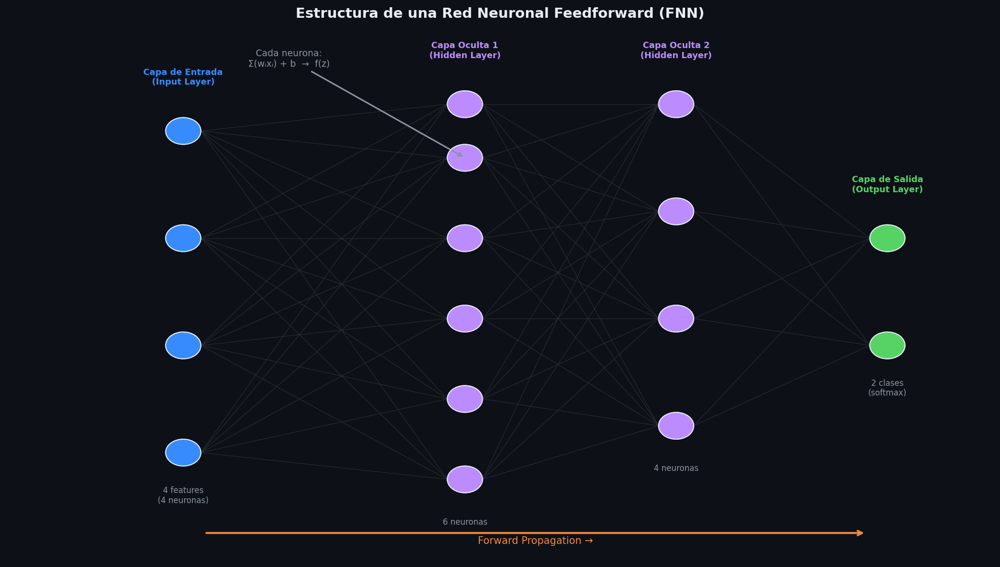
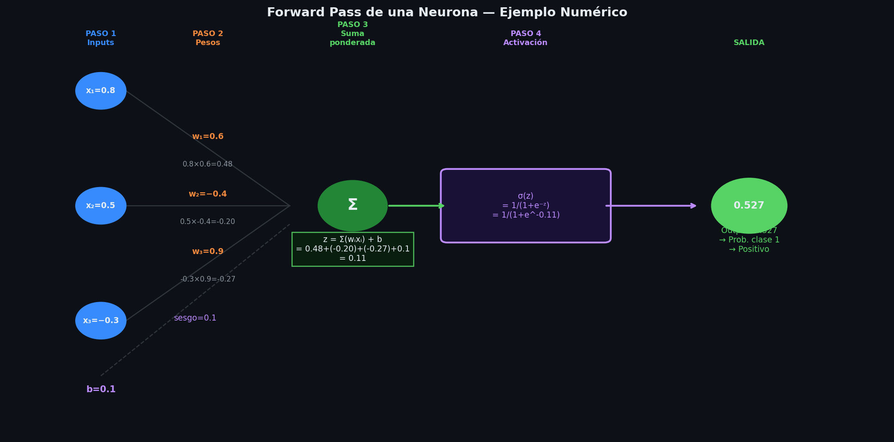
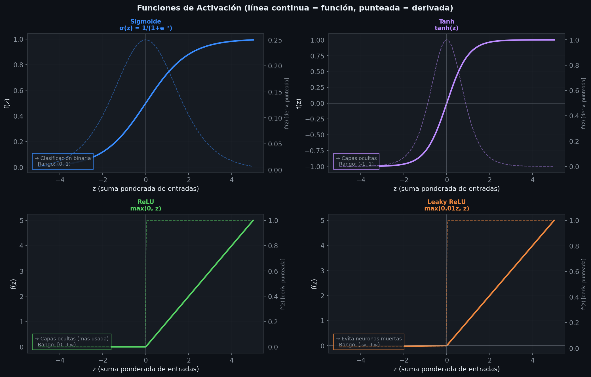
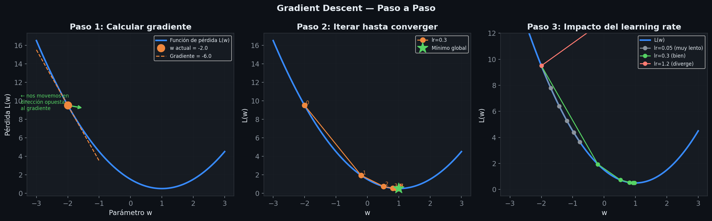
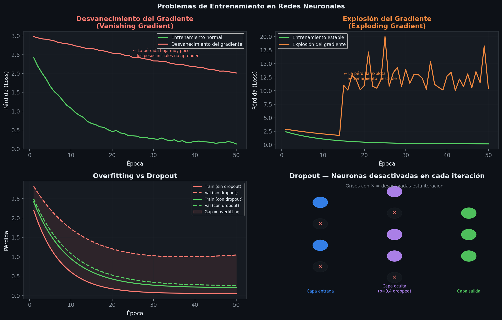
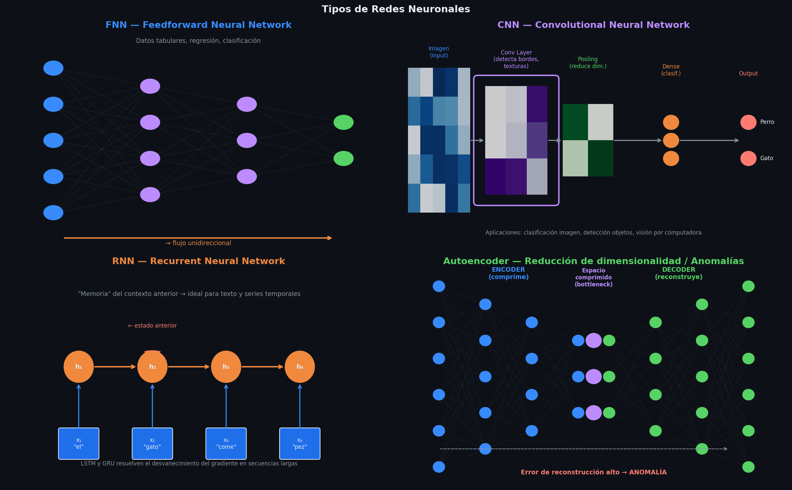

# Resumen: redes neuronales y Deep Learning

> Tema 4, RA5
> Basado en IABD_MP2_T04.pdf + Clase 6.pdf
> Visualizaciones generadas por: [visualizaciones_redes_neuronales.ipynb](visual/RA5/visualizaciones_redes_neuronales.ipynb)

---

## 1. ¿Qué es el Deep Learning?

**Deep Learning (Aprendizaje Profundo):** rama del Machine Learning que utiliza redes neuronales artificiales con múltiples capas ("deep" = profundo = muchas capas ocultas) para aprender patrones complejos en grandes volúmenes de datos.

> **Importante:** No es el mejor algoritmo para todo. Coexiste con los algoritmos de ML clásico. Hay que elegir según el problema.

**Jerarquía:**
```
Inteligencia Artificial
  └── Machine Learning
        └── Deep Learning (redes neuronales profundas)
              └── IA Generativa (LLM, GAN, Diffusion)
```

---

## 2. Estructura de una Red Neuronal



### Tipos de capas

| Capa | Función | Detalles |
|------|---------|----------|
| **Capa de entrada (Input layer)** | Recibir los datos | No realiza cálculos. Número de neuronas = número de características de entrada |
| **Capas ocultas (Hidden layers)** | Procesamiento y aprendizaje | Número variable. Aquí se aprenden los patrones. El tipo de capa define el modelo (FNN, CNN, RNN…) |
| **Capa de salida (Output layer)** | Predicción final | Neuronas según el problema: 1 (binaria/regresión), $C$ (multiclase donde $C$ = número de clases) |

**Ejemplo:** imagen 28×28 píxeles en escala de grises:
- Input layer: $28 \times 28 = 784$ neuronas
- Hidden layers: por ejemplo 128 neuronas + 64 neuronas
- Output layer: 1 neurona (binaria) o 10 neuronas (dígitos 0–9)

---

## 3. Funcionamiento de una Neurona



Cada neurona realiza 3 pasos en orden:

### Paso 1: Recepción de inputs

Recibe un valor numérico de cada neurona de la capa anterior. En la primera capa, son los datos de entrada directamente.

### Paso 2: Suma ponderada y sesgo

$$z = \sum_{j=1}^{n} w_j \cdot x_j + b$$

**Símbolos:**
- $x_j$ — valor de entrada $j$ (output de la neurona $j$ de la capa anterior). Rango: cualquier número real
- $w_j$ — peso de la conexión con la entrada $j$. Rango: cualquier número real. **Es lo que el modelo aprende**
- $b$ — sesgo (bias). Valor constante sumado al final. Permite al modelo desplazar la función de activación. Rango: cualquier número real
- $n$ — número de entradas que recibe la neurona
- $z$ — resultado antes de la función de activación. Rango: cualquier número real

> **Intuición:** los pesos indican la "importancia" de cada entrada. Si $w_j$ es grande, esa entrada influye mucho en la neurona.

### Paso 3: Función de activación

Se aplica $f(z)$ al resultado de la suma ponderada para obtener la **salida de la neurona**:

$$\text{output} = f(z)$$

---

## 4. Funciones de Activación



### Sigmoide

$$\sigma(z) = \frac{1}{1 + e^{-z}}$$

**Símbolos:**
- $e$ — número de Euler $\approx 2.718$. Base del logaritmo natural
- $e^{-z}$ — cuando $z$ es muy grande, $e^{-z} \to 0$, entonces $\sigma(z) \to 1$. Cuando $z$ es muy negativo, $e^{-z} \to \infty$, entonces $\sigma(z) \to 0$
- **Rango de salida:** $(0, 1)$, interpretable como probabilidad

**Tabla de comportamiento:**

| $z$ | $\sigma(z)$ |
|-----|-------------|
| $-\infty$ | $\approx 0$ |
| $-2$ | $\approx 0.12$ |
| $0$ | $0.5$ |
| $2$ | $\approx 0.88$ |
| $+\infty$ | $\approx 1$ |

**Uso:** capa de salida en **clasificación binaria**. También en capas ocultas (aunque puede causar desvanecimiento del gradiente).

---

### Softmax (clasificación multiclase)

$$\text{Softmax}(z_c) = \frac{e^{z_c}}{\sum_{k=1}^{C} e^{z_k}}$$

**Símbolos:**
- $z_c$ — puntuación (logit) para la clase $c$. Rango: cualquier número real
- $C$ — número total de clases
- $e^{z_c}$ — exponencial de la puntuación de la clase $c$ (siempre positivo)
- $\sum_{k=1}^{C} e^{z_k}$ — suma de exponenciales de todas las clases (para normalizar)
- **Resultado:** vector de $C$ valores entre 0 y 1 que **suman exactamente 1** → probabilidades de pertenecer a cada clase

**Ejemplo con 3 clases y logits $[2, 1, 0.1]$:**
- $e^2 \approx 7.39$, $e^1 \approx 2.72$, $e^{0.1} \approx 1.11$
- Suma $\approx 11.22$
- Probabilidades $\approx [0.66, 0.24, 0.10]$ → la clase 1 es la más probable

**Uso:** siempre en la capa de salida de **clasificación multiclase**.

---

### Tangente Hiperbólica (tanh)

$$\tanh(z) = \frac{e^z - e^{-z}}{e^z + e^{-z}}$$

- **Rango:** $(-1, 1)$. Centrada en 0 (ventaja sobre sigmoide que está centrada en 0.5)
- Forma de S similar a la sigmoide pero más amplia
- **Uso:** capas ocultas. Facilita la convergencia cuando los datos pueden ser negativos.

---

### ReLU (Rectified Linear Unit)

$$\text{ReLU}(z) = \max(0, z) = \begin{cases} 0 & \text{si } z < 0 \\ z & \text{si } z \geq 0 \end{cases}$$

- **Rango:** $[0, +\infty)$. No acotado por arriba.
- Computacionalmente muy eficiente (solo comparar con 0)
- Evita el desvanecimiento del gradiente en la parte positiva
- **Problema:** puede generar neuronas muertas (si $z < 0$ siempre, la neurona siempre da 0 y no aprende)
- **Uso:** capas ocultas. Es la más usada hoy en día.
- **Variante:** Leaky ReLU — permite valores ligeramente negativos: $\text{LeakyReLU}(z) = \max(0.01z, z)$

---

### Resumen de funciones de activación

| Función | Rango | Uso principal | Problema |
|---------|-------|--------------|----------|
| Sigmoide | $(0, 1)$ | Salida clasificación binaria | Desvanecimiento gradiente |
| Softmax | $(0,1)$ suma = 1 | Salida clasificación multiclase | — |
| Tanh | $(-1, 1)$ | Capas ocultas | Desvanecimiento gradiente |
| ReLU | $[0, +\infty)$ | Capas ocultas | Neuronas muertas |
| Leaky ReLU | $(-\infty, +\infty)$ | Capas ocultas | — |

---

## 5. Proceso de Entrenamiento

El proceso se repite iterativamente hasta converger:

### Paso 1: Inicialización de pesos

| Técnica | Descripción | Cuándo usar |
|---------|-------------|-------------|
| **Aleatoria** (pesos pequeños) | Valores aleatorios pequeños para romper simetría | Default |
| **Transfer Learning** | Usar pesos de una red ya entrenada | Pocos datos propios |
| **Xavier** | $w \sim \mathcal{N}\!\left(0, \frac{1}{n_{in}}\right)$ | Con activación lineal o tanh |
| **He** | $w \sim \mathcal{N}\!\left(0, \frac{2}{n_{in}}\right)$ | Con activación ReLU |

- $n_{in}$ — número de entradas de esa capa

### Paso 2: Forward Propagation

El dato de entrenamiento atraviesa la red de izquierda a derecha, capa por capa, hasta obtener la predicción final.

Para cada neurona: $\text{output} = f\!\left(\sum_j w_j x_j + b\right)$

### Paso 3: Cálculo del error (función de pérdida)

Se mide qué tan lejos está la predicción de la realidad.

Para **regresión:** $\text{MSE} = \frac{1}{n}\sum_{i=1}^n (\hat{y}_i - y_i)^2$

Para **clasificación binaria** (log-loss):

$$\mathcal{L} = -\frac{1}{n} \sum_{i=1}^{n} \left[ y_i \log(p_i) + (1 - y_i) \log(1 - p_i) \right]$$

**Símbolos:**
- $n$ — número de ejemplos. Siempre $\geq 1$
- $y_i$ — etiqueta real del ejemplo $i$. Solo puede ser **0 o 1**
- $p_i$ — probabilidad predicha por el modelo de que el ejemplo $i$ sea clase 1. Rango: $(0, 1)$
- $\log$ — logaritmo natural. $\log(1) = 0$ (penalización nula). $\log(x) \to -\infty$ cuando $x \to 0$ (penalización enorme)

**Intuición:**
- Si $y_i = 1$ (es positivo) y $p_i = 0.99$: $-\log(0.99) \approx 0.01$ → penalización muy pequeña ✓
- Si $y_i = 1$ (es positivo) y $p_i = 0.01$: $-\log(0.01) \approx 4.6$ → penalización enorme ✗

Para **clasificación multiclase** (cross-entropy):

$$\mathcal{L} = -\frac{1}{n} \sum_{i=1}^{n} \sum_{c=1}^{C} y_{ic} \log(p_{ic})$$

**Símbolos adicionales:**
- $C$ — número de clases
- $y_{ic}$ — indicador 0/1: vale **1** si el ejemplo $i$ pertenece a la clase $c$, y **0** en caso contrario. Solo uno de los $C$ valores es 1 (one-hot encoding)
- $p_{ic}$ — probabilidad predicha de que el ejemplo $i$ sea de clase $c$ (salida del Softmax). Rango: $(0, 1)$

> **Truco:** como $y_{ic} = 0$ para todas las clases excepto la correcta, solo el término de la clase correcta contribuye al error.

### Paso 4: Backward Propagation (Backpropagation)

Se usa el error calculado para actualizar los pesos de la red, de la capa de salida hacia la capa de entrada (de ahí "back").

---

## 6. Gradient Descent (Descenso de Gradiente)



El algoritmo clave del backpropagation.

**Idea:** el gradiente de la función de pérdida respecto a un peso indica en qué dirección y cuánto hay que cambiar ese peso para reducir el error.

$$w_j \leftarrow w_j - \alpha \cdot \frac{\partial \mathcal{L}}{\partial w_j}$$

**Símbolos:**
- $w_j$ — peso que se va a actualizar. Rango: cualquier número real
- $\alpha$ — **tasa de aprendizaje** (learning rate). Rango: $(0, 1)$, típicamente $[0.0001, 0.1]$. Controla el tamaño del paso. Si es muy grande: inestabilidad. Si es muy pequeño: aprendizaje muy lento
- $\frac{\partial \mathcal{L}}{\partial w_j}$ — derivada parcial de la función de pérdida respecto al peso $w_j$ (el gradiente). Indica cuánto cambia el error si cambiamos $w_j$

**El signo menos:** se resta el gradiente porque queremos ir en la dirección opuesta al gradiente (dirección de máxima disminución del error).

### Variantes de Gradient Descent

| Variante | Descripción | Característica |
|----------|-------------|---------------|
| **SGD** (Stochastic GD) | Usa 1 solo ejemplo por actualización | Rápido pero ruidoso |
| **Mini-batch SGD** | Usa un lote pequeño (ej: 32, 64, 128 ejemplos) | Balance entre SGD y GD completo |
| **Momentum** | Acumula gradientes anteriores para suavizar el camino | Más estable que SGD |
| **RMSprop** | Divide el gradiente por media móvil de gradientes recientes | Adapta el LR por parámetro |
| **Adam** | Combina Momentum + RMSprop | El más usado en la práctica: rápido y robusto |
| **Adagrad** | LR adaptativo: acumula todos los gradientes anteriores | Bueno para datos dispersos |

> **Adam** es el optimizador por defecto en la mayoría de frameworks modernos.

---

## 7. Problemas en el Entrenamiento y Soluciones



### Desvanecimiento del gradiente

**Qué es:** los gradientes se vuelven extremadamente pequeños al propagarse hacia capas iniciales → los pesos de las primeras capas apenas se actualizan → entrenamiento muy lento o nulo.

**Por qué ocurre:** multiplicar muchos valores pequeños (derivadas de sigmoide o tanh, que están entre 0 y 1) da un número aún más pequeño.

**Síntomas:** entrenamiento muy lento, resultados malos en capas iniciales.

**Soluciones:**
- Cambiar activación a **ReLU** (su derivada es 1 para valores positivos)
- Usar inicialización **Xavier o He**
- Usar optimizadores avanzados (**Adam, Adagrad**)
- Usar arquitecturas específicas (**LSTM** para RNNs)

---

### Explosión del gradiente

**Qué es:** lo contrario — gradientes extremadamente grandes → actualizaciones inestables.

**Soluciones:**
- **Gradient clipping** (limitar el valor máximo del gradiente)
- Cambiar activación a **sigmoide o tanh**
- Cambiar inicialización
- Usar **Adam o Adagrad**

---

### Neuronas muertas

**Qué es:** neuronas con peso siempre = 0 → no contribuyen al aprendizaje.

**Por qué ocurre:** principalmente con ReLU cuando el input es siempre negativo.

**Soluciones:**
- **Dropout** (evita dependencia excesiva de neuronas)
- Cambiar a **Leaky ReLU**
- Cambiar inicialización

---

### Overfitting (Sobreajuste)

**Qué es:** el modelo memoriza los datos de entrenamiento y no generaliza.

**Síntoma:** error bajo en training, error alto en validation/test.

**Solución específica de redes neuronales — Dropout:**
- En cada iteración, se desactivan aleatoriamente un porcentaje de neuronas (parámetro: tasa de dropout, típicamente 0.2–0.5)
- Fuerza a la red a no depender de neuronas concretas → mejora generalización
- Solo se aplica durante el entrenamiento, no en inferencia

**Otras soluciones:** reducir número de capas/neuronas, regularización L1/L2, early stopping.

---

### Underfitting (Infraajuste)

**Qué es:** el modelo es demasiado simple para capturar la complejidad de los datos.

**Síntoma:** error alto tanto en training como en validation/test.

**Soluciones:** añadir más capas y neuronas, añadir más datos, mejorar las características de entrada.

---

## 8. Principales Tipos de Redes Neuronales



### FNN — Feedforward Neural Network

- Información fluye en una sola dirección: entrada → capas ocultas → salida. Sin bucles.
- La más básica (el perceptrón es el caso más simple: solo entrada y salida)
- **Aplicaciones:** regresión y clasificación con datos tabulares donde los modelos de ML clásico no capturan bien las relaciones no lineales

---

### CNN — Convolutional Neural Network

- Diseñada para datos con estructura espacial (imágenes, videos)
- Capas especiales: **convolucionales** (detectan patrones locales: bordes, texturas) y **pooling** (reducen dimensionalidad preservando lo relevante)
- Los filtros (kernels) se deslizan sobre la imagen detectando características en pequeñas regiones
- Requiere grandes datasets y es costosa computacionalmente
- Muy adecuada para **transfer learning**

**Aplicaciones:** clasificación de imágenes, detección de objetos, segmentación, reconocimiento facial

**Variantes:** U-Net (segmentación), ResNet, DenseNet (problemas complejos donde la CNN clásica falla)

---

### RNN — Recurrent Neural Network

- Diseñada para **datos secuenciales** (texto, series temporales, voz)
- Capas recurrentes: cada nodo recibe el input actual + estado anterior → "memoria" del contexto previo
- Problema: desvanecimiento del gradiente en dependencias largas

**Tipos:**

| Tipo | Memoria | Cuándo usarlo |
|------|---------|--------------|
| **RNN clásica** | Corto plazo | Secuencias cortas |
| **LSTM** (Long Short-Term Memory) | Largo plazo | Series temporales largas, NLP |
| **GRU** (Gated Recurrent Unit) | Largo plazo | Alternativa más ligera a LSTM |

**Aplicaciones:** predicción de series temporales (finanzas), reconocimiento de voz, procesamiento de texto

---

### Autoencoders

- Red que **comprime** el dato a una representación de menor dimensión (encoder) y luego lo **reconstruye** (decoder)
- El error de reconstrucción mide qué tan bien se reconstruye el dato original:

$$\text{Error de reconstrucción} = d(\hat{x}, x) = \sqrt{\sum_j (\hat{x}_j - x_j)^2}$$

- **Para detección de anomalías:** un autoencoder entrenado con datos normales reconstruye mal los datos anómalos → alto error de reconstrucción → anomalía
- **Para reducción de dimensionalidad:** el espacio comprimido del encoder es la representación de baja dimensión

**Ventajas:** flexible, generaliza bien a cualquier tipo de dato
**Desventajas:** requiere muchos datos, computacionalmente más costoso que Isolation Forest

---

## 9. IA Generativa

Los modelos de IA Generativa aprenden a **generar nuevos contenidos** similares a los datos con los que fueron entrenados.

### LLM — Large Language Models

- Basados en arquitectura **Transformer** (paper "Attention is all you need", 2017)
- Entrenados sobre enormes cantidades de texto
- Generan texto prediciendo la siguiente palabra más probable dado el contexto
- **No piensan** — generan texto estadísticamente coherente con el prompt
- **No son deterministas** — misma pregunta puede dar respuestas diferentes
- **Alucinación:** pueden generar información incorrecta pero convincente

**Modelos:** GPT (OpenAI/Microsoft), Llama (Meta), PaLM (Google)

**Aplicaciones:** generación de texto, clasificación, análisis de sentimiento, generación de código, traducción, resumen

---

### GAN — Generative Adversarial Network

- Dos redes que **compiten entre sí**:
  - **Generador:** crea datos sintéticos que se parecen a los reales
  - **Discriminador:** intenta distinguir datos reales de sintéticos
- El juego adversarial mejora iterativamente la calidad del generador

**Aplicaciones:** generación de imágenes realistas, video, transformación de estilo, datos sintéticos para entrenamiento

---

### Modelos de Difusión (Diffusion Models)

- **Difusión directa:** se añade ruido progresivamente al dato hasta que es irreconocible
- **Difusión inversa:** el modelo aprende a eliminar el ruido paso a paso → puede generar nuevas muestras

**Aplicaciones:** generación de imágenes y video de alta calidad (más estables que GAN)

---

### Tabla resumen IA Generativa

| Modelo | Tipo de dato | Arquitectura base | Ejemplos |
|--------|-------------|-------------------|----------|
| **LLM** | Texto | Transformer | ChatGPT, Llama, PaLM |
| **GAN** | Imagen/video/tabular | Generador + Discriminador | DALL-E v1, StyleGAN |
| **Diffusion** | Imagen/audio/video | UNet + proceso iterativo | Stable Diffusion, DALL-E v2/3 |

---

## 10. Comparación Deep Learning vs ML Clásico

| Criterio | ML Clásico | Deep Learning |
|----------|-----------|--------------|
| **Datos necesarios** | Relativamente pocos | Grandes volúmenes |
| **Feature engineering** | Manual | Automático (la red aprende las features) |
| **Interpretabilidad** | Alta (regresión lineal, árbol) | Baja (caja negra) |
| **Coste computacional** | Bajo | Alto (GPU/TPU necesarios) |
| **Relaciones no lineales** | Limitado (SVM, árboles parcialmente) | Muy bueno |
| **Datos tabulares** | Muy bueno | A veces no supera ML clásico |
| **Imagen / voz / texto** | Limitado | Estado del arte |

---

## 11. Conceptos Clave para el Examen

- **Red neuronal:** capas de neuronas que procesan datos con suma ponderada + función de activación
- La **función de activación** introduce no-linealidad, sin ella la red sería equivalente a una regresión lineal
- **Pesos** son los parámetros que se aprenden. **Hiperparámetros** (número de capas, neuronas, learning rate) se fijan antes
- **Forward prop** → calcular predicción. **Backward prop** → actualizar pesos con el gradiente
- **Adam** = Momentum + RMSprop: el optimizador más usado
- **Dropout** es la técnica anti-overfitting específica de redes neuronales (desactiva neuronas aleatoriamente)
- **Desvanecimiento del gradiente** → ReLU, Adam, LSTM
- **Explosión del gradiente** → gradient clipping, sigmoide/tanh, Adam
- **CNN** → imágenes. **RNN/LSTM** → secuencias. **Autoencoders** → anomalías/reducción de dimensión. **FNN** → tabular
- **LLM** = Transformers + grandes textos. No piensan, predicen la siguiente palabra

### Preguntas tipo test (respuesta correcta marcada con ✓)

**¿Cuál es la principal ventaja del deep learning vs ML tradicional?**
- ✓ Capacidad para procesar grandes volúmenes de datos y aprender características complejas automáticamente
- ✗ Requiere menos datos y es más fácil de interpretar

**¿Las CNN son especialmente adecuadas para procesamiento de imágenes?**
- ✓ Verdadero

**¿Qué tipo de red neuronal se usa principalmente para secuencias y datos temporales?**
- ✓ RNN

**¿Qué técnica evita el sobreajuste en deep learning?**
- ✓ Todas las anteriores (aumento de datos, normalización, regularización L2, dropout)

**¿A qué tipo de red corresponde cada afirmación?**
- Reducción de dimensionalidad y reconstrucción → **Autoencoders**
- Secuencias temporales y texto → **RNN**
- Visión por computadora, clasificación de imágenes → **CNN**
- Capas de pooling → **CNN**
- Celdas LSTM o GRU → **RNN**
- Sin mecanismos para secuencias ni espacialidad → **FNN**
