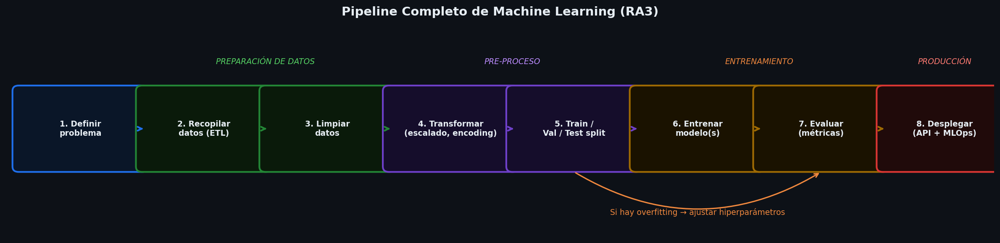
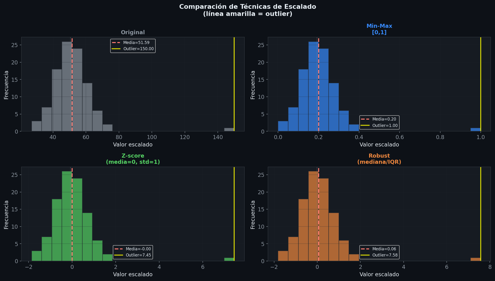
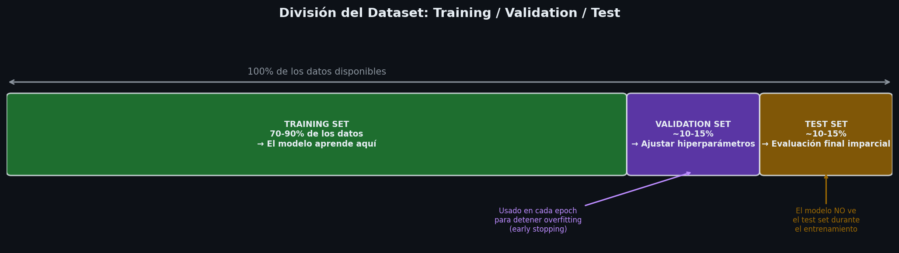
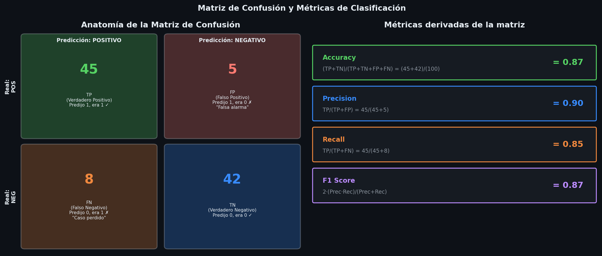
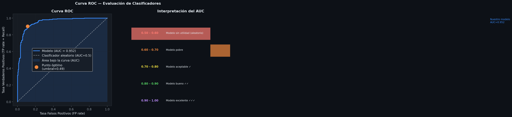
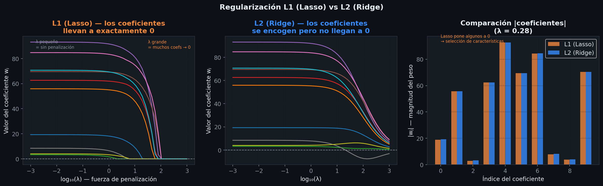
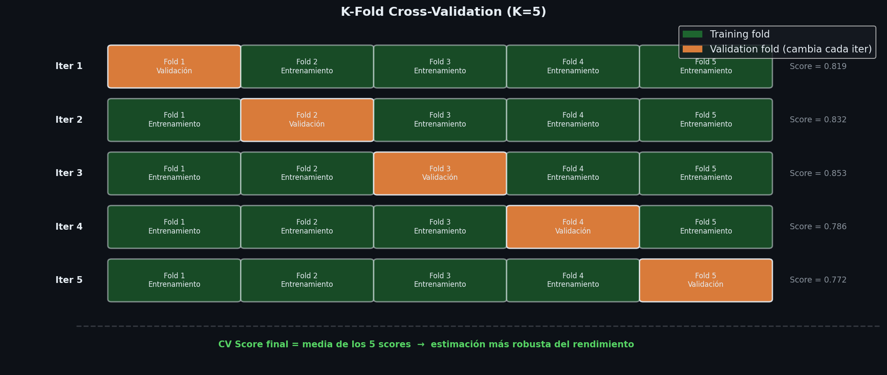

# Resumen: selección de algoritmos, entrenamiento, optimización y despliegue

> Tema 3, RA3 y RA6
> Basado en IABD_MP2_T03.pdf + Clase 5.pdf
> Visualizaciones generadas por: [visualizaciones_entrenamiento_y_evaluacion.ipynb](visual/RA3_RA6/visualizaciones_entrenamiento_y_evaluacion.ipynb)

---

## 1. Determinación del tipo de problema y modelo

### Paso 1: ¿Supervisado o no supervisado?

| Criterio | Supervisado | No supervisado |
|----------|-------------|----------------|
| ¿Hay etiquetas? | Sí | No |
| Objetivo | Predecir etiqueta o valor | Encontrar patrones o grupos |
| ¿Se puede medir con métricas? | Sí (accuracy, MSE…) | No de forma objetiva |

### Paso 2: Análisis exploratorio de los datos

Antes de elegir modelo, estudiar:

| Factor | Implicación |
|--------|-------------|
| **Tipo de datos** | Numéricos → regresión lineal, árboles. Texto → LSTM, Transformers. Imagen → CNN |
| **Dimensionalidad** | Alta → SVM, redes neuronales. Baja → regresión lineal |
| **Tamaño del dataset** | Pequeño → modelos simples. Grande → redes neuronales |
| **Clases desbalanceadas** | Sobremuestreo, submuestreo, árboles de decisión |
| **Relaciones no lineales** | SVM con kernel, árboles, redes neuronales |
| **Outliers / ruido** | Bosques aleatorios, ensemble |
| **Necesidad de interpretabilidad** | Regresión lineal, árbol de decisión (fáciles de explicar) |

---

## 2. Pre-procesamiento de datos

> "Aproximadamente el 80% del tiempo en un proyecto de ML se dedica a preparar y limpiar los datos."

### 2.1 Extracción (ETL)

- **ETL** = Extract, Transform, Load. Documentado y replicable.
- Fuentes: datos privados del cliente, bases públicas (Kaggle, datos gubernamentales).

### 2.2 Calidad de los datos (6 criterios)

| Criterio | Qué significa |
|----------|--------------|
| **Cantidad** | Suficientes datos para que el modelo aprenda patrones |
| **Diversidad** | Representar todas las variaciones del problema |
| **Relevancia** | Solo datos útiles para el problema (datos irrelevantes = ruido) |
| **Precisión** | Datos correctos; datos erróneos → modelo erróneo |
| **Completitud** | Sin valores ni etiquetas faltantes |
| **Consistencia** | Mismo criterio de etiquetado en todo el dataset |

### 2.3 Limpieza de datos

**Valores faltantes (missing values):**
- Pocos → eliminar registros
- Muchos → **imputación**: rellenar con la media, mediana, o con KNN

**Outliers:**
- Detectar con boxplots, scatterplots, rango intercuartílico (IQR)
- Opciones: eliminarlos si son errores, o aplicar transformaciones:
  - $x' = \log(x)$ — reduce asimetría
  - $x' = \sqrt{x}$ — reduce varianza

**Duplicados y errores:** eliminar registros duplicados.

### 2.4 Transformación de datos

#### Escalado y normalización

| Técnica | Fórmula | Cuándo usar |
|---------|---------|-------------|
| **Min-Max scaling** | $x' = \dfrac{x - x_{\min}}{x_{\max} - x_{\min}}$ | Preservar proporciones. Rango: $[0, 1]$. Sensible a outliers |
| **Robust scaling** | $x' = \dfrac{x - \text{mediana}}{\text{IQR}}$ | Con outliers. Usa mediana e IQR |
| **Z-score (estandarización)** | $x' = \dfrac{x - \mu}{\sigma}$ | Distribución normal. Rango típico: $[-3, 3]$ |
| **Log normalization** | $x' = \log(x)$ | Datos muy asimétricos. No válido para $x \leq 0$ |

**Explicación de símbolos (Min-Max):**
- $x$ — valor original del dato
- $x_{\min}$ — valor mínimo de esa variable en todo el dataset
- $x_{\max}$ — valor máximo de esa variable en todo el dataset
- $x'$ — valor transformado, siempre entre 0 y 1

**Explicación de símbolos (Z-score):**
- $\mu$ — media de esa variable en el dataset. Rango: cualquier valor real
- $\sigma$ — desviación estándar. Siempre $\geq 0$. Mide cuánto se dispersan los valores alrededor de la media
- $x'$ — número de desviaciones estándar que el dato está alejado de la media

#### Codificación de variables categóricas

| Técnica | Descripción | Cuándo usar |
|---------|-------------|-------------|
| **One-Hot encoding** | Crea columna binaria (0/1) por cada categoría | Sin orden implícito. Problema: muchas columnas si hay muchas categorías |
| **Label encoding** | Asigna número entero a cada categoría (Rojo=0, Verde=1…) | Si hay orden natural en las categorías |
| **Target encoding** | Reemplaza categoría por media del target para esa categoría | En supervisado. Riesgo de overfitting |

#### Feature Engineering (generación de características)

- Transformaciones matemáticas: $\log(x)$, $\sqrt{x}$, $x^2$
- Interacciones: multiplicar o dividir características ($x_1 \cdot x_2$)
- Estadísticos: media, frecuencia de aparición

#### Reducción de dimensionalidad (pre-proceso)

- **Selección de características**: chi-cuadrado, correlación de Pearson, información mutua
- **Métodos wrapper**: prueba subconjuntos de características con modelos
- **Métodos integrados**: Lasso, Ridge, Random Forest (hacen selección de forma intrínseca)
- **Algoritmos**: PCA, LDA, t-SNE

### 2.5 División del dataset (solo supervisado)

| Conjunto | Proporción típica | Para qué sirve |
|----------|-------------------|----------------|
| **Training set** | 70–90% | El modelo aprende de estos datos |
| **Validation set** | 5–15% | Ajuste de hiperparámetros durante el entrenamiento |
| **Test set** | 5–15% | Evaluación final imparcial (simula producción) |

> Los algoritmos **no supervisados** usan todos los datos como training set (no hay etiquetas que esconder).

---

## 3. Fases del aprendizaje automático

### 3.1 Configuración del modelo

Antes de entrenar, definir:
- Modelo(s) a entrenar
- Framework (Scikit-learn, TensorFlow, Keras, PyTorch)
- **Inicialización de pesos**: aleatoria, estadística, transfer learning, Xavier, He, LeCun

### 3.2 Métricas de evaluación para **clasificación**

#### Matriz de confusión (clasificación binaria)

|  | Predicción positiva | Predicción negativa |
|--|---------------------|---------------------|
| **Real positivo** | TP (True Positive) | FN (False Negative) |
| **Real negativo** | FP (False Positive) | TN (True Negative) |

- **TP** — predijo 1, era 1 ✓
- **TN** — predijo 0, era 0 ✓
- **FP** — predijo 1, era 0 ✗ (falsa alarma)
- **FN** — predijo 0, era 1 ✗ (caso perdido)

#### Métricas derivadas

$$\text{Accuracy} = \frac{TP + TN}{TP + TN + FP + FN}$$

- **Qué mide:** porcentaje de predicciones correctas sobre el total
- **Rango:** $[0, 1]$. Más cerca de 1 = mejor
- **Cuidado:** puede ser engañosa en clases desbalanceadas

$$\text{Precision} = \frac{TP}{TP + FP}$$

- **Qué mide:** de todas las veces que el modelo dice "positivo", ¿cuántas acierta?
- **Cuándo priorizarla:** cuando un **falso positivo es grave** (ej: spam — mejor no bloquear un email legítimo)

$$\text{Recall} = \frac{TP}{TP + FN}$$

- **Qué mide:** de todos los positivos reales, ¿cuántos encontró el modelo?
- **Cuándo priorizarlo:** cuando un **falso negativo es grave** (ej: cáncer — mejor no perder un caso real)

$$\text{F1 score} = 2 \cdot \frac{\text{Precision} \cdot \text{Recall}}{\text{Precision} + \text{Recall}}$$

- **Qué mide:** media armónica entre Precision y Recall. Balance entre ambas.
- **Rango:** $[0, 1]$
- **Por qué media armónica y no media normal:** penaliza más cuando uno de los dos valores es muy bajo

#### Precision vs Recall — ¿cuándo priorizar cada una?

| Problema | Métrica a priorizar | Por qué |
|----------|---------------------|---------|
| Detección de fraude bancario | Precision | FP grave: bloquear transacción legítima molesta al cliente |
| Detección de cáncer | Recall | FN grave: no detectar un cáncer real puede costar una vida |
| Alerta de desastres naturales | Recall | FN grave: no avisar de un desastre real es catastrófico |
| Control de calidad medicamentos | Recall | FN grave: dejar pasar un medicamento defectuoso es peligroso |
| Detección de intrusos | Precision | FP grave: falsa alarma genera desconfianza |
| Contaminantes en agua | Recall | FN grave: no detectar contaminación es peligroso |

#### Curva ROC y AUC

- **Curva ROC:** gráfico construido variando el umbral de decisión de 0 a 1. Eje X = FP rate, Eje Y = TP rate
- **AUC** (Área bajo la curva ROC):

$$\text{AUC} = \int_0^1 \text{ROC}(t)\, dt$$

- **Rango:** $[0, 1]$. AUC = 0.5 → modelo aleatorio. AUC = 1 → modelo perfecto
- **Valor bueno:** AUC $\geq 0.75$

### 3.3 Métricas de evaluación para **regresión**

$$\text{MSE} = \frac{1}{n} \sum_{i=1}^{n} (\hat{y}_i - y_i)^2$$

**Símbolos:**
- $n$ — número total de datos. Siempre $\geq 1$
- $\hat{y}_i$ — valor **predicho** por el modelo para el dato $i$. Puede ser cualquier número real
- $y_i$ — valor **real** (etiqueta) del dato $i$. Puede ser cualquier número real
- $(\hat{y}_i - y_i)^2$ — error al cuadrado (siempre $\geq 0$; penaliza errores grandes: un error de 10 pesa 100 veces más que uno de 1)

**Cuándo usarlo:** es la métrica más usada en regresión por ser estable y diferenciable (necesario para el backpropagation).

**Variantes:**
- $\text{RMSE} = \sqrt{\text{MSE}}$ — misma unidad que los datos, más interpretable
- $\text{MAE} = \frac{1}{n}\sum_{i=1}^{n}|\hat{y}_i - y_i|$ — menos sensible a outliers, no diferenciable en 0
- $\text{MAPE} = \frac{1}{n}\sum_{i=1}^{n}\left|\frac{\hat{y}_i - y_i}{y_i}\right| \cdot 100\%$ — error en porcentaje, interpretable

$$R^2 = 1 - \frac{\sum_{i=1}^{n}(y_i - \hat{y}_i)^2}{\sum_{i=1}^{n}(y_i - \bar{y})^2}$$

**Símbolos:**
- $\bar{y}$ — media de todos los valores reales $y_i$
- Numerador: suma de errores cuadráticos del modelo
- Denominador: varianza total de los datos (qué tan dispersos están los valores reales)
- **Rango:** $[0, 1]$. Cercano a 1 = el modelo explica bien la varianza. Cercano a 0 = el modelo no aporta nada respecto a predecir siempre la media

### 3.4 Métricas para **clustering** (no supervisado)

$$s(i) = \frac{b(i) - a(i)}{\max(a(i),\, b(i))}$$

**Índice de silueta — símbolos:**
- $i$ — punto de datos concreto
- $a(i)$ — distancia promedio entre el punto $i$ y todos los demás puntos **del mismo clúster** (mide cohesión interna; $a(i)$ pequeño = el punto está bien agrupado)
- $b(i)$ — distancia promedio entre el punto $i$ y todos los puntos del **clúster más cercano al que no pertenece** (mide separación entre clústeres; $b(i)$ grande = el punto está bien separado de otros grupos)
- **Rango:** $[-1, 1]$. Cercano a 1 = bien agrupado. Cercano a -1 = mal asignado. Cercano a 0 = en la frontera

**Índice de Dunn:**

$$D = \frac{\min_{i \neq j} d(C_i, C_j)}{\max_k \text{diam}(C_k)}$$

- Numerador: mínima distancia entre puntos de clústeres distintos (separación)
- Denominador: máximo diámetro de un clúster (dispersión interna)
- **Rango:** $[0, +\infty)$. Valores altos = clústeres compactos y bien separados

### 3.5 Técnicas anti-overfitting

**¿Qué es el overfitting?** El modelo memoriza los datos de entrenamiento y falla con datos nuevos. Lo detectamos cuando el error en training es bajo pero en validation/test es alto.

#### Regularización L1 (Lasso), L2 (Ridge) y Elastic Net

La regularización añade un término de penalización a la función de pérdida:

$$\mathcal{L}_{\text{L1}} = \mathcal{L} + \lambda \sum_{j=1}^{p} |w_j|$$

$$\mathcal{L}_{\text{L2}} = \mathcal{L} + \lambda \sum_{j=1}^{p} w_j^2$$

$$\mathcal{L}_{\text{ElasticNet}} = \mathcal{L} + \lambda_1 \sum_{j=1}^{p} |w_j| + \lambda_2 \sum_{j=1}^{p} w_j^2$$

**Símbolos:**
- $\mathcal{L}$ — función de pérdida original (ej: MSE o cross-entropy)
- $\lambda$, $\lambda_1$, $\lambda_2$ — hiperparámetros de penalización. Rango: $[0, +\infty)$. Más grande = más penalización = modelo más simple
- $w_j$ — peso $j$ del modelo. Rango: cualquier número real
- $p$ — número total de pesos (parámetros) del modelo

**Diferencia clave:**
- **L1 (Lasso):** tiende a poner pesos exactamente a 0 → selección de características automática
- **L2 (Ridge):** distribuye el error entre todas las características → más estable con alta correlación
- **Elastic Net:** combina ambos → lo mejor de los dos

#### Early Stopping

Monitorizar la métrica de validación. Si no mejora después de $k$ epochs (paciencia), parar y restaurar los mejores pesos.

#### Cross-Validation (Validación cruzada)

Dividir el dataset en $K$ folds del mismo tamaño. En cada iteración, uno es el validation set y el resto training. Se promedian los resultados.

$$\text{CV score} = \frac{1}{K} \sum_{k=1}^{K} \text{score}_k$$

- **$K$ típico:** 3, 5 o 10
- **Stratified K-fold:** asegura que cada fold mantiene la misma proporción de clases (útil con clases desbalanceadas)

### 3.6 Ajuste de hiperparámetros

Los **hiperparámetros** son parámetros de arquitectura que se fijan antes del entrenamiento (no se aprenden).

| Técnica | Cómo funciona | Ventaja / Inconveniente |
|---------|--------------|-------------------------|
| **Grid Search** | Prueba todas las combinaciones posibles | Exhaustivo pero costoso computacionalmente |
| **Random Search** | Prueba un número fijo de combinaciones aleatorias | Más eficiente, puede no encontrar el óptimo |
| **Bayesian Optimization** | Construye modelo probabilístico para guiar la búsqueda | Más complejo pero más eficiente que Grid Search |

---

## 4. Optimización del modelo entrenado

Una vez entrenado, antes de desplegar, reducir tamaño/coste sin sacrificar rendimiento:

| Técnica | Descripción |
|---------|-------------|
| **Cuantización** | Reducir precisión de los números (ej: float32 → int8) |
| **Poda (Pruning)** | Eliminar conexiones/neuronas con pesos muy bajos (solo redes neuronales) |
| **Codificación Huffman** | Compresión de datos asignando códigos más cortos a valores frecuentes |
| **Formato ONNX** | Estándar abierto para interoperabilidad entre frameworks (Microsoft/Facebook) |
| **Pickle / Joblib** | Formatos ligeros para modelos simples |
| **HDF5** | Formato optimizado para Keras/TensorFlow |
| **GPU/TPU** | Paralelización en hardware específico para inferencia rápida |

---

## 5. Despliegue y MLOps

### Despliegue en producción

El modelo se despliega en un servidor (Cloud) accesible vía **API REST**:
- Cliente envía datos en una petición HTTP autenticada
- La API responde con la predicción (inferencia)

### MLOps — buenas prácticas

| Práctica | Herramientas | Para qué |
|----------|-------------|----------|
| **Control de versiones** | Git, DVC, MLflow, TensorBoard | Reproducibilidad, trazabilidad, colaboración |
| **CI/CD** | Jenkins, GitHub, GitLab, Docker, Kubernetes | Automatizar pipelines de desarrollo y despliegue |
| **Monitorización** | Prometheus, Grafana, Kibana | Detectar degradación del modelo en producción |

---

## 6. Plataformas y Frameworks

| Framework | Para qué | Características |
|-----------|----------|----------------|
| **Scikit-learn** | ML clásico | Simple, eficiente. Integra con NumPy, Pandas, Matplotlib |
| **TensorFlow** | Todo tipo de modelos, incluidas redes neuronales | Ciclo de vida completo. Herramienta TensorBoard |
| **Keras** | Redes neuronales | Más simple e intuitivo que TF. Integrado en TF |
| **PyTorch** | Redes neuronales | Mayor flexibilidad. Muy usada en investigación |

**Entornos de desarrollo:**
- **Jupyter Notebook / Google Colab** — prototipado e iteración rápida
- **VS Code / PyCharm** — desarrollo, compilación y despliegue

**Proveedores Cloud con plataformas low-code:**
- Google Cloud AutoML
- Azure ML Designer (Microsoft)

---

## 7. Conceptos Clave para el Examen

- El proceso ML completo sigue este orden: **problema → datos → modelo → train/val → hiperparámetros → optimizar → desplegar → monitorizar**
- **Overfitting** = bajo error en train, alto error en test → regularización, early stopping, cross-validation
- **Underfitting** = alto error en train → modelos más complejos, más datos
- **Precision** se prioriza cuando el FP es grave. **Recall** se prioriza cuando el FN es grave
- **AUC ≥ 0.75** se considera bueno
- **R²** entre 0 y 1: cercano a 1 = buen ajuste
- **Índice de silueta** entre -1 y 1: cercano a 1 = clúster bien definido
- El formato de guardado óptimo para modelos de redes neuronales es **ONNX**
- Los pesos del modelo **NO** siempre se inicializan aleatoriamente (también hay Xavier, He, transfer learning)
- La última fase del desarrollo de un modelo es el **despliegue**

### Preguntas tipo test (respuesta correcta marcada con ✓)

**¿Cuál es un formato de almacenamiento optimizado para un modelo ya entrenado?**
- ✓ ONNX
- ✗ ZIP

**¿Los pesos de un modelo siempre se inicializan de manera aleatoria?**
- ✓ Falso

**¿Cuál se utiliza para evaluar la precisión de un modelo de clasificación?**
- ✓ Matriz de confusión

**¿Cuál es la última fase en el proceso de desarrollo de un modelo de ML?**
- ✓ Despliegue del modelo
