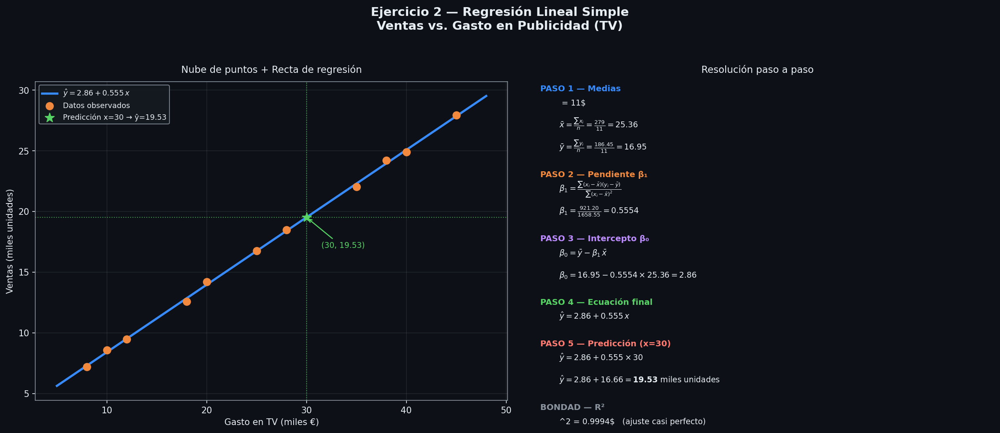
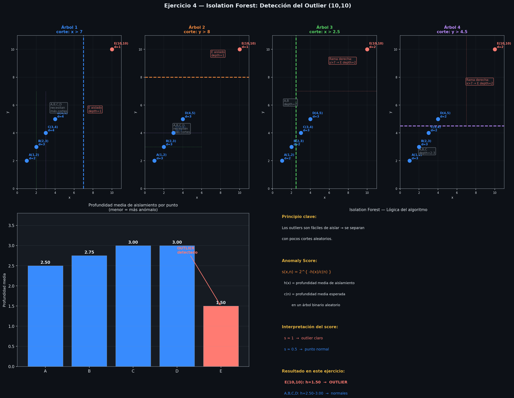

# Resumen con ejercicios resueltos: sistemas de aprendizaje automático (Machine Learning)

> Tema 2
> Basado en: IABD_MP2_T02.pdf, Clase 2.pdf, Clase 3.pdf
> Ejercicios resueltos: ACT_OBL_T02 (Ejercicios 1–5)
> Visualizaciones: [visualizaciones_machine_learning.ipynb](visual/RA2_RA4/visualizaciones_machine_learning.ipynb)

---

## 1. ¿Qué es el Machine Learning?

Subdisciplina de la IA que desarrolla algoritmos que **aprenden patrones a partir de datos** en vez de seguir reglas programadas explícitamente.

| NO es ML                            | SÍ es ML                        |
| ----------------------------------- | -------------------------------- |
| Chatbot estático con reglas fijas  | Regresión lineal, KNN, SVM      |
| Modelos estadísticos clásicos     | Random Forest, DBSCAN            |
| Robots autónomos basados en reglas | Redes neuronales (Deep Learning) |

**Deep Learning** ⊂ **Machine Learning** ⊂ **Inteligencia Artificial**

---

## 2. Tipos de Aprendizaje

### 2.1 Supervisado

El modelo se entrena con datos **etiquetados** (cada entrada tiene su salida esperada).

**Requisitos de los datos:**

- Calidad y ausencia de outliers
- Equilibrio y representatividad entre clases
- Volumen suficiente
- Consistencia en el etiquetado

**Proceso:**

1. Selección y etiquetado de datos → split train/val/test
2. Selección del modelo
3. Entrenamiento iterativo minimizando la **función de pérdida** (loss function)
4. Despliegue + monitorización (MLOps)

> El modelo supervisado ofrece siempre una **probabilidad** asociada a cada predicción, no solo una clase.

---

### 2.2 No Supervisado

El modelo se entrena con datos **sin etiquetar**. Busca patrones y estructuras ocultas.

**Diferencias clave respecto al supervisado:**

- Se usa **todo el dataset** para entrenar (no hay split train/val/test)
- Las métricas de evaluación se basan en la **estructura de los datos**, no en aciertos/errores
- Requiere **normalización previa** de los datos

---

### 2.3 Semi-supervisado

Combina datos etiquetados y no etiquetados. Útil cuando etiquetar es costoso.

- **Active Learning:** el propio modelo selecciona qué ejemplos necesita que etiquete un humano (prioriza los datos donde tiene más dudas)
- **Auto-supervisado:** el modelo genera sus propias etiquetas automáticamente (riesgo de baja calidad)

---

### 2.4 Aprendizaje por Refuerzo (Reinforcement Learning)

Aprende por **prueba y error**: el agente recibe recompensas o penalizaciones según sus acciones.

| Elemento              | Descripción                                     |
| --------------------- | ------------------------------------------------ |
| **Agente**      | El modelo / sistema que toma decisiones          |
| **Entorno**     | El mundo con el que interactúa el agente        |
| **Acciones**    | Las decisiones posibles en cada paso             |
| **Recompensas** | Señal numérica de feedback (+ bueno / − malo) |
| **Estados**     | Representación del entorno en cada instante     |

**Características:**

- Sin dataset estático etiquetado
- Equilibrio exploración vs. explotación
- Aprendizaje secuencial (decisiones con impacto a largo plazo)

> **Ejemplo paradigmático:** conducción autónoma (Ejercicio 5)

---

## 3. Técnicas de Ensemble Learning

Combina múltiples modelos para superar las limitaciones individuales.

| Técnica           | Cómo funciona                                                                                                    |
| ------------------ | ----------------------------------------------------------------------------------------------------------------- |
| **Bagging**  | Entrena modelos en subconjuntos aleatorios (con reemplazo) y combina predicciones por confianza. Reduce varianza. |
| **Boosting** | Modelos secuenciales: cada uno corrige los errores del anterior. Los datos mal clasificados reciben más peso.    |
| **Voting**   | Cada modelo emite un voto. Votación dura (igual peso) o blanda (ponderada por confianza).                        |

**Transfer Learning:** partir de un modelo pre-entrenado y ajustarlo con nuevos datos (**fine-tuning**). Ahorra tiempo y datos.

---

## 4. Algoritmos de Clasificación (Supervisado)

### Tipos de clasificación

| Tipo                     | Descripción              | Ejemplo                                         |
| ------------------------ | ------------------------- | ----------------------------------------------- |
| **Binaria**        | 2 clases                  | Spam / No spam                                  |
| **Multi-clase**    | N clases, una por dato    | Gato / Perro / Coche                            |
| **Multi-etiqueta** | N clases, varias por dato | Artículo: "IA" + "Tecnología" + "Innovación" |

---

### 4.1 Regresión Logística

Predice la **probabilidad** de pertenecer a una clase mediante la función sigmoide:

$$
\sigma(z) = \frac{1}{1 + e^{-z}}
$$

| Símbolo      | Significado                                                                              | Rango                  |
| ------------- | ---------------------------------------------------------------------------------------- | ---------------------- |
| $z$         | Combinación lineal de las entradas:$z = \beta_0 + \beta_1 x_1 + \ldots + \beta_n x_n$ | $(-\infty, +\infty)$ |
| $\sigma(z)$ | Probabilidad de pertenecer a la clase positiva                                           | $(0, 1)$             |
| $\beta_0$   | Sesgo (intercept)                                                                        | $\mathbb{R}$         |
| $\beta_i$   | Peso de la variable$x_i$                                                               | $\mathbb{R}$         |

**Función de pérdida — Log-loss (Cross-entropy binaria):**

$$
\mathcal{L} = -\frac{1}{n} \sum_{i=1}^{n} \left[ y_i \log(p_i) + (1 - y_i)\log(1 - p_i) \right]
$$

| Símbolo | Significado                             | Rango        |
| -------- | --------------------------------------- | ------------ |
| $y_i$  | Etiqueta real del dato$i$             | $\{0, 1\}$ |
| $p_i$  | Probabilidad predicha para el dato$i$ | $(0, 1)$   |

**Para multi-clase — Softmax:**

$$
\text{softmax}(z_i) = \frac{e^{z_i}}{\sum_{j=1}^{k} e^{z_j}}
$$

Convierte $k$ puntuaciones en $k$ probabilidades que suman 1.

**Ventajas:** interpretable, rápido, probabilidades asociadas
**Desventajas:** peor con relaciones no lineales o muchos outliers

---

### 4.2 Support Vector Machines (SVM)

Encuentra el **hiperplano que maximiza el margen** entre clases.

- **Margen:** distancia entre el hiperplano y los vectores de soporte (puntos más cercanos)
- **Kernel:** transforma datos no lineales a una dimensión superior donde sí son separables linealmente

**Ventajas:** robusto con datos complejos y alta dimensión
**Desventajas:** complejo, sensible al kernel elegido, riesgo de overfitting

---

### 4.3 Naive Bayes

Aplica el **teorema de Bayes** asumiendo independencia entre características:

$$
P(A|B) = \frac{P(B|A) \cdot P(A)}{P(B)}
$$

| Símbolo    | Significado                                       |
| ----------- | ------------------------------------------------- |
| $P(A)$    | Probabilidad previa de la clase A                 |
| $P(B\|A)$ | Probabilidad de observar B dado que la clase es A |
| $P(A\|B)$ | Probabilidad posterior de A dado que se observa B |

**Ventajas:** rápido, funciona bien con datasets grandes y pequeños
**Desventajas:** la suposición de independencia no siempre se cumple

---

### 4.4 K-Nearest Neighbors (KNN)

Asigna la clase por **votación de los K vecinos más cercanos** en el espacio de características.

**Distancia euclídea:**

$$
d(p, q) = \sqrt{\sum_{j=1}^{m}(p_j - q_j)^2}
$$

**Proceso:** calcular distancias → encontrar K más cercanos → votar clase mayoritaria.

**Ventajas:** intuitivo, robusto ante outliers (raramente son vecinos)
**Desventajas:** muy lento con datasets grandes ($O(n^2)$), sensible al valor de K

---

## 5. Algoritmos de Regresión (Supervisado)

Predicen un **valor continuo** (no una clase).

### 5.1 Regresión Lineal Simple — **[Ejercicio 2 resuelto]**

$$
\hat{y} = \beta_0 + \beta_1 x
$$

**Cálculo de coeficientes por mínimos cuadrados (forma directa):**

$$
\beta_1 = \frac{n\sum(x_i y_i) - \sum x_i \sum y_i}{n\sum(x_i^2) - \left(\sum x_i\right)^2}
$$

$$
\beta_0 = \bar{y} - \beta_1 \bar{x}
$$

> Forma equivalente por desviaciones: $\beta_1 = \dfrac{\sum(x_i-\bar{x})(y_i-\bar{y})}{\sum(x_i-\bar{x})^2}$ — mismo resultado, diferente notación.

| Símbolo             | Significado                                    |
| -------------------- | ---------------------------------------------- |
| $\hat{y}$          | Valor predicho                                 |
| $\beta_0$          | Intercepto (valor de$y$ cuando $x=0$)      |
| $\beta_1$          | Pendiente (cambio en$y$ por unidad de $x$) |
| $\bar{x}, \bar{y}$ | Medias de$x$ e $y$ respectivamente         |
| $n$                | Número de observaciones                       |

**Función de pérdida — MSE:**

$$
MSE = \frac{1}{n}\sum_{i=1}^{n}(y_i - \hat{y}_i)^2
$$

**Bondad del ajuste — R²:**

$$
R^2 = 1 - \frac{\sum(y_i - \hat{y}_i)^2}{\sum(y_i - \bar{y})^2}
$$

$R^2 \in [0,1]$: cuanto más cercano a 1, mejor el ajuste.

#### Resolución Ejercicio 2

Dataset (Gasto TV en miles € vs. Ventas en miles de unidades):

| $x_i$      | $y_i$          | $x_i y_i$       | $x_i^2$      |
| ------------ | ---------------- | ----------------- | -------------- |
| 8            | 7.20             | 57.60             | 64             |
| 10           | 8.60             | 86.00             | 100            |
| 12           | 9.50             | 114.00            | 144            |
| 18           | 12.60            | 226.80            | 324            |
| 20           | 14.20            | 284.00            | 400            |
| 25           | 16.75            | 418.75            | 625            |
| 28           | 18.50            | 518.00            | 784            |
| 35           | 22.05            | 771.75            | 1225           |
| 38           | 24.20            | 919.60            | 1444           |
| 40           | 24.90            | 996.00            | 1600           |
| 45           | 27.95            | 1257.75           | 2025           |
| **Σ** | **186.45** | **5650.25** | **8735** |

$n = 11$ · $\sum x_i = 279$ · $\bar{x} = 279/11 = 25.36$ · $\bar{y} = 186.45/11 = 16.95$

$$
\beta_1 = \frac{11 \times 5650.25 - 279 \times 186.45}{11 \times 8735 - 279^2} = \frac{62152.75 - 52019.55}{96085 - 77841} = \frac{10133.20}{18244} = 0.555
$$

$$
\beta_0 = 16.95 - 0.555 \times 25.36 = 2.86
$$

$$
\boxed{\hat{y} = 2.86 + 0.555\,x}
$$

**Predicción para x = 30 (30.000€):**

$$
\hat{y} = 2.86 + 0.555 \times 30 = \mathbf{19.51 \text{ miles de unidades}}
$$

$R^2 = 0.9994$ → ajuste prácticamente perfecto.

### 5.1 Regresión Lineal Simple — **[Ejercicio 2 resuelto]**

$$
\hat{y} = \beta_0 + \beta_1 x
$$

**Cálculo de coeficientes por mínimos cuadrados:**

$$
\beta_1 = \frac{\sum_{i=1}^{n}(x_i - \bar{x})(y_i - \bar{y})}{\sum_{i=1}^{n}(x_i - \bar{x})^2}
$$

$$
\beta_0 = \bar{y} - \beta_1 \bar{x}
$$

| Símbolo             | Significado                                    |
| -------------------- | ---------------------------------------------- |
| $\hat{y}$          | Valor predicho                                 |
| $\beta_0$          | Intercepto (valor de$y$ cuando $x=0$)      |
| $\beta_1$          | Pendiente (cambio en$y$ por unidad de $x$) |
| $\bar{x}, \bar{y}$ | Medias de$x$ e $y$ respectivamente         |

**Función de pérdida — MSE:**

$$
MSE = \frac{1}{n}\sum_{i=1}^{n}(y_i - \hat{y}_i)^2
$$

**Bondad del ajuste — R²:**

$$
R^2 = 1 - \frac{\sum(y_i - \hat{y}_i)^2}{\sum(y_i - \bar{y})^2}
$$

$R^2 \in [0,1]$: cuanto más cercano a 1, mejor el ajuste.

#### Resolución Ejercicio 2

Dataset (Gasto TV en miles € vs. Ventas en miles de unidades):

| $x_i$      | $y_i$ | $(x_i-\bar{x})$ | $(y_i-\bar{y})$ | $(x_i-\bar{x})(y_i-\bar{y})$ | $(x_i-\bar{x})^2$ |
| ------------ | ------- | ----------------- | ----------------- | ------------------------------ | ------------------- |
| 8            | 7.20    | −17.36           | −9.75            | 169.27                         | 301.37              |
| 10           | 8.60    | −15.36           | −8.35            | 128.26                         | 235.93              |
| 12           | 9.50    | −13.36           | −7.45            | 99.53                          | 178.49              |
| 18           | 12.60   | −7.36            | −4.35            | 32.02                          | 54.17               |
| 20           | 14.20   | −5.36            | −2.75            | 14.74                          | 28.73               |
| 25           | 16.75   | −0.36            | −0.20            | 0.07                           | 0.13                |
| 28           | 18.50   | +2.64             | +1.55             | 4.09                           | 6.97                |
| 35           | 22.05   | +9.64             | +5.10             | 49.16                          | 92.93               |
| 38           | 24.20   | +12.64            | +7.25             | 91.64                          | 159.77              |
| 40           | 24.90   | +14.64            | +7.95             | 116.39                         | 214.33              |
| 45           | 27.95   | +19.64            | +11.00            | 216.04                         | 385.73              |
| **Σ** |         |                   |                   | **921.21**               | **1658.56**   |

$\bar{x} = 279/11 = 25.36$ · $\bar{y} = 186.45/11 = 16.95$

$$
\beta_1 = \frac{921.21}{1658.56} = 0.555 \qquad \beta_0 = 16.95 - 0.555 \times 25.36 = 2.86
$$

$$
\boxed{\hat{y} = 2.86 + 0.555\,x}
$$

**Predicción para x = 30 (30.000€):**

$$
\hat{y} = 2.86 + 0.555 \times 30 = \mathbf{19.51 \text{ miles de unidades}}
$$

$R^2 = 0.9994$ → ajuste prácticamente perfecto.

---

## 6. Algoritmos de Clustering (No Supervisado)

### **[Ejercicio 3 resuelto]**

| Dataset                                  | Algoritmo                        | Razón clave                                              |
| ---------------------------------------- | -------------------------------- | --------------------------------------------------------- |
| Clusters pequeños + muchos outliers     | **DBSCAN**                 | Etiqueta outliers como ruido nativamente                  |
| Dos donuts concéntricos                 | **DBSCAN**                 | Propaga por densidad, sin suponer forma esférica         |
| Clusters esféricos y de tamaño similar | **K-Means**                | Diseñado exactamente para esta geometría                |
| Estructura jerárquica natural           | **Clustering Jerárquico** | El dendrograma representa niveles de agrupación anidados |

### 6.1 K-Means

**Proceso iterativo:**

1. Seleccionar K centroides aleatorios
2. Asignar cada punto al centroide más cercano
3. Recalcular centroides como la media del cluster
4. Repetir hasta convergencia

**Distancia euclídea al centroide:**

$$
d(x, \mu_k) = \sqrt{\sum_{j=1}^{m}(x_j - \mu_{k,j})^2}
$$

**Función objetivo (inercia):**

$$
J = \sum_{k=1}^{K}\sum_{x_i \in C_k} \|x_i - \mu_k\|^2
$$

**Ventajas:** rápido, escalable · **Desventajas:** sensible a outliers, asume clusters esféricos

---

### 6.2 Clustering Jerárquico

Construye un **dendrograma** fusionando clusters de más cercanos a más lejanos. Se puede cortar a cualquier nivel para obtener distintos números de clusters.

**Ventajas:** interpretable, no requiere K fijo · **Desventajas:** $O(n^2 \log n)$, no escala bien

---

### 6.3 DBSCAN

Parámetros: $\varepsilon$ (radio de vecindad), $\text{minPts}$ (mínimo de vecinos para ser núcleo).

- **Punto núcleo:** $|N_\varepsilon(p)| \geq \text{minPts}$
- **Punto alcanzable:** dentro del radio $\varepsilon$ de un núcleo
- **Ruido (outlier):** ni núcleo ni alcanzable desde ningún núcleo

**Ventajas:** detecta outliers, cualquier forma · **Desventajas:** sensible a $\varepsilon$ y minPts, malo con densidades muy distintas

---

## 7. Árboles de Decisión y Derivados (Supervisado)

### 7.1 Árbol de Decisión

Estructura en árbol donde cada nodo es una condición sobre un atributo y cada hoja es una predicción.

**Elementos:** nodo raíz → nodos internos (condiciones) → ramas (resultados) → hojas (clases/valores)

**Ventajas:** muy interpretable, maneja datos categóricos y numéricos
**Desventajas:** tendencia al overfitting por sí solo

---

### 7.2 Random Forest (Bosque Aleatorio)

Ensemble de múltiples árboles entrenados con **Bagging** + selección aleatoria de atributos.

- **Clasificación:** voto por mayoría entre todos los árboles
- **Regresión:** promedio de las predicciones

Mayor precisión y robustez que un árbol individual.

---

### 7.3 Boosting (AdaBoost, XGBoost, LightGBM, CatBoost)

Árboles construidos **secuencialmente**: cada árbol corrige los errores del anterior, dando más peso a los datos mal clasificados.

---

## 8. Detección de Anomalías

### 8.1 Isolation Forest (No supervisado) — **[Ejercicio 4 resuelto]**

**Principio:** los outliers se aíslan en pocos cortes aleatorios; los puntos normales necesitan más.

**Proceso:**

1. Construir múltiples árboles aleatorios (iTrees) con cortes de atributo y valor aleatorios
2. Calcular $h(x)$: profundidad media de aislamiento de cada punto en todos los árboles
3. Calcular el anomaly score:

$$
s(x,n) = 2^{-\,h(x)\,/\,c(n)}
$$

donde $c(n) = 2\,H(n-1) - \frac{2(n-1)}{n}$ es la profundidad media esperada en un BST con $n$ puntos y $H(k)$ es el número armónico.

| $s \approx 1$   | Outlier claro |
| ----------------- | ------------- |
| $s \approx 0.5$ | Punto normal  |

#### Resolución Ejercicio 4

Puntos: A=(1,2), B=(2,3), C=(3,4), D=(4,5), **E=(10,10)**

| Punto       | Árbol 1 (x>7) | Árbol 2 (y>8) | Árbol 3 (x>2.5) | Árbol 4 (y>4.5) | h(x) media     |
| ----------- | -------------- | -------------- | ---------------- | ---------------- | -------------- |
| A           | 2              | 3              | 2                | 3                | 2.50           |
| B           | 3              | 3              | 2                | 3                | 2.75           |
| C           | 4              | 3              | 3                | 2                | 3.00           |
| D           | 4              | 3              | 3                | 2                | 3.00           |
| **E** | **1**    | **1**    | **2**      | **2**      | **1.50** |

**Cálculo de $H(k)$ — número armónico:**

$$
H(k) = \sum_{i=1}^{k} \frac{1}{i} = 1 + \frac{1}{2} + \frac{1}{3} + \cdots + \frac{1}{k}
$$

$$
H(4) = 1 + \frac{1}{2} + \frac{1}{3} + \frac{1}{4} = 1 + 0.5 + 0.333 + 0.25 = 2.083
$$

**Cálculo de $c(n)$ — profundidad media esperada con $n=5$ puntos:**

$$
c(5) = 2 \cdot H(4) - \frac{2 \cdot 4}{5} = 2 \times 2.083 - 1.6 = 2.567
$$

| Punto       | h(x)           | h(x)/c(n)       | $s = 2^{-h/c}$           |
| :---------- | -------------- | --------------- | -------------------------- |
| A           | 2.50           | 0.974           | 0.509                      |
| B           | 2.75           | 1.071           | 0.476                      |
| C           | 3.00           | 1.169           | 0.445                      |
| D           | 3.00           | 1.169           | 0.445                      |
| **E** | **1.50** | **0.584** | **0.667** ← OUTLIER |

$s(E) = 0.667 > 0.5$ → E=(10,10) es el **único outlier** del dataset.

---

### 8.2 LOF (Local Outlier Factor) y K-Means para anomalías

Basados en KNN: un punto es outlier si su densidad local es mucho menor que la de sus vecinos (LOF), o si está muy lejos del centroide más cercano (K-Means).

### 8.3 One-Class SVM (Supervisado)

Clasifica cada dato como normal o anómalo usando el hiperplano SVM. Útil con relaciones no lineales.

---

## 9. Reducción de Dimensionalidad — PCA

Transforma los datos en un espacio de menor dimensión conservando la máxima varianza.

**Estandarización previa:**

$$
x' = \frac{x - \mu}{\sigma}
$$

**Varianza explicada por componente $k$:**

$$
VE_k = \frac{\lambda_k}{\sum_j \lambda_j}
$$

donde $\lambda_k$ es el autovalor de la componente $k$. Se eligen las componentes que acumulan ~95% de varianza explicada.

---

## 10. Aprendizaje por Refuerzo — **[Ejercicio 5 resuelto]**

### Conducción Autónoma

| Elemento RL           | En conducción autónoma                                                                     |
| --------------------- | -------------------------------------------------------------------------------------------- |
| **Agente**      | Sistema de IA embebido en el vehículo                                                       |
| **Entorno**     | Carretera, otros vehículos, señales, meteorología                                         |
| **Acciones**    | Acelerar, frenar, girar, cambiar de carril, detenerse                                        |
| **Recompensas** | + avanzar correctamente / − exceso de velocidad, colisión, atropello                       |
| **Estados**     | Posición, velocidad, distancias a obstáculos, señales detectadas, condiciones ambientales |

---

## 11. Clasificación de Tipos de Problemas — **[Ejercicio 1 resuelto]**

| Problema                                  | Tipo                                   |
| ----------------------------------------- | -------------------------------------- |
| Spam / No spam                            | Clasificación**binaria**        |
| Sentimiento positivo / negativo / neutral | Clasificación**multi-clase**    |
| Detección de objetos en imagen           | Clasificación**multi-etiqueta** |
| Tipo de documento (contrato, factura…)   | Clasificación**multi-clase**    |
| Tags para un artículo de blog            | Clasificación**multi-etiqueta** |
| Clasificación de animales en especies    | Clasificación**multi-clase**    |
| Productos defectuosos en fabricación     | Clasificación**binaria**        |

---

## 12. Tabla Resumen de Algoritmos

| Algoritmo             | Tipo           | Problema        | Fortaleza                           | Debilidad                        |
| --------------------- | -------------- | --------------- | ----------------------------------- | -------------------------------- |
| Regresión Logística | Supervisado    | Clasificación  | Interpretable, rápido              | Mal con no-lineal                |
| SVM                   | Supervisado    | Clas. / Reg.    | Alta dimensión, no lineal (kernel) | Complejo, overfitting            |
| Naive Bayes           | Supervisado    | Clasificación  | Rápido, funciona con poco dato     | Asume independencia              |
| KNN                   | Supervisado    | Clas. / Reg.    | Intuitivo, robusto ante outliers    | Lento con n grande               |
| Regresión Lineal     | Supervisado    | Regresión      | Simple, interpretable               | Sensible a outliers              |
| Árbol de Decisión   | Supervisado    | Clas. / Reg.    | Muy interpretable                   | Overfitting                      |
| Random Forest         | Supervisado    | Clas. / Reg.    | Robusto, preciso                    | Menos interpretable              |
| Boosting (XGBoost…)  | Supervisado    | Clas. / Reg.    | Máxima precisión                  | Lento, muchos hiperparámetros   |
| K-Means               | No supervisado | Clustering      | Rápido, escalable                  | Asume forma esférica            |
| Jerárquico           | No supervisado | Clustering      | Dendrograma, sin K fijo             | $O(n^2)$, no escala            |
| DBSCAN                | No supervisado | Clustering      | Outliers nativos, cualquier forma   | Sensible a$\varepsilon$/minPts |
| Isolation Forest      | No supervisado | Anomalías      | Eficiente, interpretable            | Sensible a nº de árboles       |
| LOF                   | No supervisado | Anomalías      | Detecta outliers locales            | Lento con n grande               |
| One-Class SVM         | Supervisado    | Anomalías      | No lineal, alta dimensión          | Complejo, poco interpretable     |
| PCA                   | No supervisado | Reducción dim. | Elimina redundancia                 | Pierde interpretabilidad         |

---

## 13. Conceptos Clave para el Examen

- **Supervisado** = datos etiquetados → clasificación (discreta) o regresión (continua)
- **No supervisado** = sin etiquetas → clustering o reducción de dimensionalidad
- **Reinforcement Learning** ≠ supervisado: aprende por recompensas, no por etiquetas
- **Ensemble** = combinar modelos. Bagging (paralelo, reduce varianza) vs. Boosting (secuencial, reduce sesgo)
- **K-Means** supone clusters **esféricos** → falla con formas arbitrarias o donuts
- **DBSCAN** es el único que trata outliers como **ruido** de forma nativa
- **Isolation Forest**: outlier = profundidad baja = $s \to 1$
- **Overfitting**: el modelo memoriza el train pero falla en datos nuevos → solucionado con regularización, ensemble, más datos
- **R²** mide bondad del ajuste en regresión: $R^2 = 1$ es ajuste perfecto, $R^2 = 0$ el modelo no aporta nada
