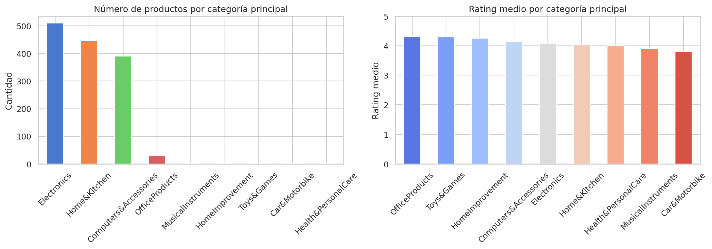
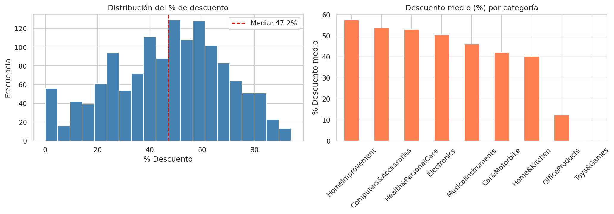
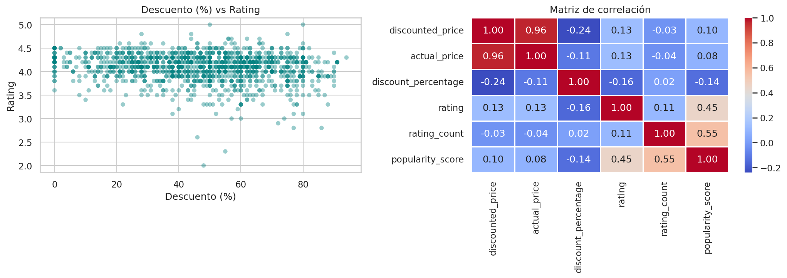
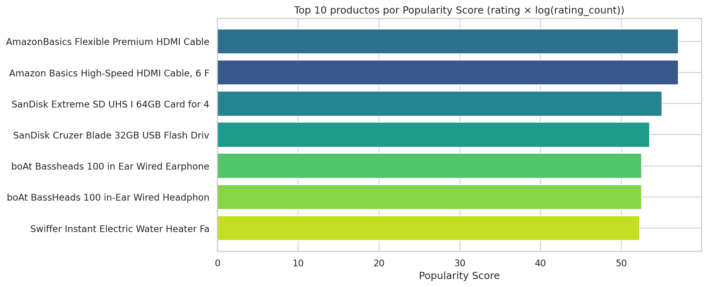
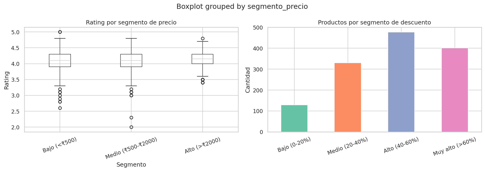
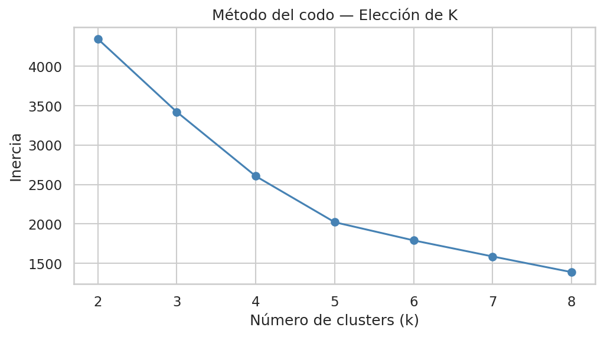
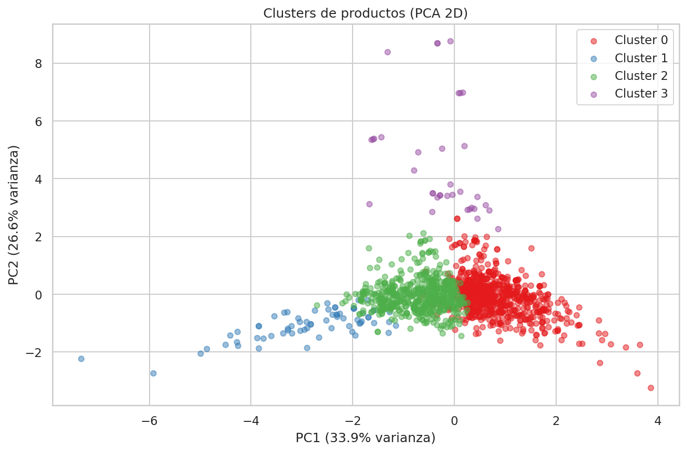

**Dataset:** Amazon Sales Dataset\
**Objetivo:** Aplicar el proceso KDD completo para extraer insights y
recomendar estrategias de ventas y marketing.

## Fases del proceso KDD

1.  Selección de datos
2.  Limpieza de datos
3.  Transformación de datos
4.  Minería de datos
5.  Interpretación y evaluación

## Fase 0: Importación de librerías

:::: {.cell execution_count="1"}
``` {.python .cell-code}
import pandas as pd
import numpy as np
import matplotlib.pyplot as plt
import seaborn as sns
import warnings

warnings.filterwarnings('ignore')
sns.set_theme(style='whitegrid', palette='muted')
plt.rcParams['figure.figsize'] = (12, 5)

print('Librerías cargadas correctamente.')
```

::: {.cell-output .cell-output-stdout}
    Librerías cargadas correctamente.
:::
::::

## Fase 1: Selección de datos

Cargamos el dataset y hacemos una exploración inicial para entender qué
columnas son relevantes para nuestro análisis de estrategias de ventas.

::::: {.cell execution_count="2"}
``` {.python .cell-code}
df_raw = pd.read_csv('amazon.csv')
print(f'Dimensiones del dataset: {df_raw.shape[0]} filas x {df_raw.shape[1]} columnas')
df_raw.head(3)
```

::: {.cell-output .cell-output-stdout}
    Dimensiones del dataset: 1465 filas x 16 columnas
:::

::: {.cell-output .cell-output-display execution_count="2"}
<div>
<style scoped>
    .dataframe tbody tr th:only-of-type {
        vertical-align: middle;
    }

    .dataframe tbody tr th {
        vertical-align: top;
    }

    .dataframe thead th {
        text-align: right;
    }
</style>

      product_id   product_name                                         category                                               discounted_price   actual_price   discount_percentage   rating   rating_count   about_product                                          user_id                                              user_name                                            review_id                                            review_title                                         review_content                                       img_link                                             product_link
  --- ------------ ---------------------------------------------------- ------------------------------------------------------ ------------------ -------------- --------------------- -------- -------------- ------------------------------------------------------ ---------------------------------------------------- ---------------------------------------------------- ---------------------------------------------------- ---------------------------------------------------- ---------------------------------------------------- ---------------------------------------------------- ----------------------------------------------------
  0   B07JW9H4J1   Wayona Nylon Braided USB to Lightning Fast Cha\...   Computers&Accessories\|Accessories&Peripherals\|\...   ₹399               ₹1,099         64%                   4.2      24,269         High Compatibility : Compatible With iPhone 12\...     AG3D6O4STAQKAY2UVGEUV46KN35Q,AHMY5CWJMMK5BJRBB\...   Manav,Adarsh gupta,Sundeep,S.Sayeed Ahmed,jasp\...   R3HXWT0LRP0NMF,R2AJM3LFTLZHFO,R6AQJGUP6P86,R1K\...   Satisfied,Charging is really fast,Value for mo\...   Looks durable Charging is fine tooNo complains\...   https://m.media-amazon.com/images/W/WEBP_40237\...   https://www.amazon.in/Wayona-Braided-WN3LG1-Sy\...
  1   B098NS6PVG   Ambrane Unbreakable 60W / 3A Fast Charging 1.5\...   Computers&Accessories\|Accessories&Peripherals\|\...   ₹199               ₹349           43%                   4.0      43,994         Compatible with all Type C enabled devices, be\...     AECPFYFQVRUWC3KGNLJIOREFP5LQ,AGYYVPDD7YG7FYNBX\...   ArdKn,Nirbhay kumar,Sagar Viswanathan,Asp,Plac\...   RGIQEG07R9HS2,R1SMWZQ86XIN8U,R2J3Y1WL29GWDE,RY\...   A Good Braided Cable for Your Type C Device,Go\...   I ordered this cable to connect my phone to An\...   https://m.media-amazon.com/images/W/WEBP_40237\...   https://www.amazon.in/Ambrane-Unbreakable-Char\...
  2   B096MSW6CT   Sounce Fast Phone Charging Cable & Data Sync U\...   Computers&Accessories\|Accessories&Peripherals\|\...   ₹199               ₹1,899         90%                   3.9      7,928          【 Fast Charger& Data Sync】-With built-in safet\...   AGU3BBQ2V2DDAMOAKGFAWDDQ6QHA,AESFLDV2PT363T2AQ\...   Kunal,Himanshu,viswanath,sai niharka,saqib mal\...   R3J3EQQ9TZI5ZJ,R3E7WBGK7ID0KV,RWU79XKQ6I1QF,R2\...   Good speed for earlier versions,Good Product,W\...   Not quite durable and sturdy,https://m.media-a\...   https://m.media-amazon.com/images/W/WEBP_40237\...   https://www.amazon.in/Sounce-iPhone-Charging-C\...

</div>
:::
:::::

::::: {.cell execution_count="3"}
``` {.python .cell-code}
# Seleccionamos las columnas relevantes para el análisis de ventas
cols_seleccionadas = [
    'product_id', 'product_name', 'category',
    'discounted_price', 'actual_price', 'discount_percentage',
    'rating', 'rating_count', 'about_product'
]

df = df_raw[cols_seleccionadas].copy()
print(f'Dataset reducido: {df.shape[0]} filas x {df.shape[1]} columnas')
df.head(3)
```

::: {.cell-output .cell-output-stdout}
    Dataset reducido: 1465 filas x 9 columnas
:::

::: {.cell-output .cell-output-display execution_count="3"}
<div>
<style scoped>
    .dataframe tbody tr th:only-of-type {
        vertical-align: middle;
    }

    .dataframe tbody tr th {
        vertical-align: top;
    }

    .dataframe thead th {
        text-align: right;
    }
</style>

      product_id   product_name                                         category                                               discounted_price   actual_price   discount_percentage   rating   rating_count   about_product
  --- ------------ ---------------------------------------------------- ------------------------------------------------------ ------------------ -------------- --------------------- -------- -------------- ------------------------------------------------------
  0   B07JW9H4J1   Wayona Nylon Braided USB to Lightning Fast Cha\...   Computers&Accessories\|Accessories&Peripherals\|\...   ₹399               ₹1,099         64%                   4.2      24,269         High Compatibility : Compatible With iPhone 12\...
  1   B098NS6PVG   Ambrane Unbreakable 60W / 3A Fast Charging 1.5\...   Computers&Accessories\|Accessories&Peripherals\|\...   ₹199               ₹349           43%                   4.0      43,994         Compatible with all Type C enabled devices, be\...
  2   B096MSW6CT   Sounce Fast Phone Charging Cable & Data Sync U\...   Computers&Accessories\|Accessories&Peripherals\|\...   ₹199               ₹1,899         90%                   3.9      7,928          【 Fast Charger& Data Sync】-With built-in safet\...

</div>
:::
:::::

**Justificación de la selección:**\
- `category`, `discounted_price`, `actual_price`, `discount_percentage`:
permiten analizar estrategia de precios y descuentos por categoría.\
- `rating` y `rating_count`: proxy de satisfacción del cliente y
popularidad del producto.\
- Se descartan columnas de texto libre (reseñas, IDs de usuario) que no
aportan valor al análisis cuantitativo.

## Fase 2: Limpieza de datos

:::: {.cell execution_count="4"}
``` {.python .cell-code}
print('=== VALORES NULOS ===')
print(df.isnull().sum())
print(f'\nTotal filas duplicadas: {df.duplicated().sum()}')

# Eliminar duplicados
df.drop_duplicates(inplace=True)

# Eliminar filas con nulos en columnas críticas
df.dropna(subset=['discounted_price', 'actual_price', 'rating', 'rating_count'], inplace=True)

print(f'Filas tras limpieza: {df.shape[0]}')
```

::: {.cell-output .cell-output-stdout}
    === VALORES NULOS ===
    product_id             0
    product_name           0
    category               0
    discounted_price       0
    actual_price           0
    discount_percentage    0
    rating                 0
    rating_count           2
    about_product          0
    dtype: int64

    Total filas duplicadas: 77
    Filas tras limpieza: 1386
:::
::::

:::: cell
``` {.python .cell-code}
def limpiar_precio(valor):
    if pd.isnull(valor):
        return np.nan
    return float(str(valor).replace('₹', '').replace(',', '').strip())

def limpiar_porcentaje(valor):
    if pd.isnull(valor):
        return np.nan
    return float(str(valor).replace('%', '').strip())

def limpiar_entero(valor):
    if pd.isnull(valor):
        return np.nan
    return float(str(valor).replace(',', '').strip())

df['discounted_price'] = df['discounted_price'].apply(limpiar_precio)
df['actual_price']     = df['actual_price'].apply(limpiar_precio)
df['discount_percentage'] = df['discount_percentage'].apply(limpiar_porcentaje)
df['rating']           = pd.to_numeric(df['rating'], errors='coerce')
df['rating_count']     = df['rating_count'].apply(limpiar_entero)

# Eliminar filas donde la conversión falló
df.dropna(subset=['discounted_price', 'actual_price', 'rating', 'rating_count'], inplace=True)

print('Tipos de datos tras limpieza:')
print(df.dtypes)
print(f'\nFilas finales limpias: {df.shape[0]}')
```

::: {.cell-output .cell-output-stdout}
    Tipos de datos tras limpieza:
    product_id                 str
    product_name               str
    category                   str
    discounted_price       float64
    actual_price           float64
    discount_percentage    float64
    rating                 float64
    rating_count           float64
    about_product              str
    dtype: object

    Filas finales limpias: 1385
:::
::::

::::: cell
``` {.python .cell-code}
print('=== ESTADÍSTICAS BÁSICAS ===')
df[['discounted_price','actual_price','discount_percentage','rating','rating_count']].describe().round(2)
```

::: {.cell-output .cell-output-stdout}
    === ESTADÍSTICAS BÁSICAS ===
:::

::: {.cell-output .cell-output-display execution_count="6"}
<div>
<style scoped>
    .dataframe tbody tr th:only-of-type {
        vertical-align: middle;
    }

    .dataframe tbody tr th {
        vertical-align: top;
    }

    .dataframe thead th {
        text-align: right;
    }
</style>

          discounted_price   actual_price   discount_percentage   rating    rating_count
  ------- ------------------ -------------- --------------------- --------- --------------
  count   1385.00            1385.00        1385.00               1385.00   1385.00
  mean    3256.43            5654.05        47.16                 4.09      18554.53
  std     7101.99            11115.32       21.67                 0.29      43709.86
  min     39.00              39.00          0.00                  2.00      2.00
  25%     349.00             899.00         31.00                 4.00      1181.00
  50%     889.00             1749.00        49.00                 4.10      5036.00
  75%     2099.00            4699.00        63.00                 4.30      17348.00
  max     77990.00           139900.00      94.00                 5.00      426973.00

</div>
:::
:::::

:::: {.cell execution_count="7"}
``` {.python .cell-code}
# Filtrar outliers evidentes: precios negativos o rating fuera de [1,5]
df = df[(df['discounted_price'] > 0) & (df['actual_price'] > 0)]
df = df[(df['rating'] >= 1) & (df['rating'] <= 5)]
df = df[(df['discount_percentage'] >= 0) & (df['discount_percentage'] <= 100)]

df.reset_index(drop=True, inplace=True)
print(f'Filas tras filtrar outliers: {df.shape[0]}')
```

::: {.cell-output .cell-output-stdout}
    Filas tras filtrar outliers: 1385
:::
::::

## Fase 3: Transformación de datos

Creamos nuevas variables que enriquecen el análisis y facilitarán la
minería de datos.

:::: {.cell execution_count="8"}
``` {.python .cell-code}
# 1. Extraer categoría principal (primer nivel antes del |)
df['main_category'] = df['category'].str.split('|').str[0].str.strip()

# 2. Ahorro absoluto en rupias
df['ahorro_rs'] = df['actual_price'] - df['discounted_price']

# 3. Segmento de precio (bajo / medio / alto)
df['segmento_precio'] = pd.cut(
    df['discounted_price'],
    bins=[0, 500, 2000, np.inf],
    labels=['Bajo (<₹500)', 'Medio (₹500-₹2000)', 'Alto (>₹2000)']
)

# 4. Score de popularidad ponderado (rating × log(rating_count))
df['popularity_score'] = df['rating'] * np.log1p(df['rating_count'])

# 5. Segmento de descuento
df['segmento_descuento'] = pd.cut(
    df['discount_percentage'],
    bins=[0, 20, 40, 60, 100],
    labels=['Bajo (0-20%)', 'Medio (20-40%)', 'Alto (40-60%)', 'Muy alto (>60%)']
)

print('Nuevas variables creadas:')
print(df[['main_category','ahorro_rs','segmento_precio','popularity_score','segmento_descuento']].head())
```

::: {.cell-output .cell-output-stdout}
    Nuevas variables creadas:
               main_category  ahorro_rs segmento_precio  popularity_score  \
    0  Computers&Accessories      700.0    Bajo (<₹500)         42.407384   
    1  Computers&Accessories      150.0    Bajo (<₹500)         42.767325   
    2  Computers&Accessories     1700.0    Bajo (<₹500)         35.015301   
    3  Computers&Accessories      370.0    Bajo (<₹500)         48.110643   
    4  Computers&Accessories      245.0    Bajo (<₹500)         40.888780   

      segmento_descuento  
    0    Muy alto (>60%)  
    1      Alto (40-60%)  
    2    Muy alto (>60%)  
    3      Alto (40-60%)  
    4    Muy alto (>60%)  
:::
::::

:::: {.cell execution_count="9"}
``` {.python .cell-code}
print(f'Categorías principales ({df["main_category"].nunique()} únicas):')
print(df['main_category'].value_counts())
```

::: {.cell-output .cell-output-stdout}
    Categorías principales (9 únicas):
    main_category
    Electronics              510
    Home&Kitchen             447
    Computers&Accessories    390
    OfficeProducts            31
    MusicalInstruments         2
    HomeImprovement            2
    Toys&Games                 1
    Car&Motorbike              1
    Health&PersonalCare        1
    Name: count, dtype: int64
:::
::::

## Fase 4: Minería de datos

Aplicamos técnicas analíticas para extraer patrones y relaciones en los
datos.

### 4.1 Análisis de distribución por categoría

::::: {.cell execution_count="10"}
``` {.python .cell-code}
cat_counts = df['main_category'].value_counts()

fig, axes = plt.subplots(1, 2, figsize=(14, 5))

# Productos por categoría
cat_counts.plot(kind='bar', ax=axes[0], color=sns.color_palette('muted'))
axes[0].set_title('Número de productos por categoría principal')
axes[0].set_xlabel('')
axes[0].set_ylabel('Cantidad')
axes[0].tick_params(axis='x', rotation=45)

# Rating medio por categoría
rating_cat = df.groupby('main_category')['rating'].mean().sort_values(ascending=False)
rating_cat.plot(kind='bar', ax=axes[1], color=sns.color_palette('coolwarm', len(rating_cat)))
axes[1].set_title('Rating medio por categoría principal')
axes[1].set_xlabel('')
axes[1].set_ylabel('Rating medio')
axes[1].set_ylim(0, 5)
axes[1].tick_params(axis='x', rotation=45)

plt.tight_layout()
plt.savefig('fig1_categorias.png', dpi=150, bbox_inches='tight')
plt.show()
print('Guardado: fig1_categorias.png')
```

::: {.cell-output .cell-output-display}

:::

::: {.cell-output .cell-output-stdout}
    Guardado: fig1_categorias.png
:::
:::::

### 4.2 Análisis de la estrategia de descuentos

::::: {.cell execution_count="11"}
``` {.python .cell-code}
fig, axes = plt.subplots(1, 2, figsize=(14, 5))

# Distribución del porcentaje de descuento
axes[0].hist(df['discount_percentage'], bins=20, color='steelblue', edgecolor='white')
axes[0].set_title('Distribución del % de descuento')
axes[0].set_xlabel('% Descuento')
axes[0].set_ylabel('Frecuencia')
axes[0].axvline(df['discount_percentage'].mean(), color='red', linestyle='--',
                label=f'Media: {df["discount_percentage"].mean():.1f}%')
axes[0].legend()

# Descuento medio por categoría
desc_cat = df.groupby('main_category')['discount_percentage'].mean().sort_values(ascending=False)
desc_cat.plot(kind='bar', ax=axes[1], color='coral')
axes[1].set_title('Descuento medio (%) por categoría')
axes[1].set_xlabel('')
axes[1].set_ylabel('% Descuento medio')
axes[1].tick_params(axis='x', rotation=45)

plt.tight_layout()
plt.savefig('fig2_descuentos.png', dpi=150, bbox_inches='tight')
plt.show()
print('Guardado: fig2_descuentos.png')
```

::: {.cell-output .cell-output-display}

:::

::: {.cell-output .cell-output-stdout}
    Guardado: fig2_descuentos.png
:::
:::::

### 4.3 Relación entre descuento y rating (¿mayor descuento = mejor valoración?)

::::: {.cell execution_count="12"}
``` {.python .cell-code}
fig, axes = plt.subplots(1, 2, figsize=(14, 5))

# Scatter: descuento vs rating
axes[0].scatter(df['discount_percentage'], df['rating'],
                alpha=0.4, color='teal', edgecolors='none', s=30)
axes[0].set_title('Descuento (%) vs Rating')
axes[0].set_xlabel('Descuento (%)')
axes[0].set_ylabel('Rating')

# Correlación numérica
corr_matrix = df[['discounted_price','actual_price','discount_percentage','rating','rating_count','popularity_score']].corr()
sns.heatmap(corr_matrix, annot=True, fmt='.2f', cmap='coolwarm', ax=axes[1], linewidths=0.5)
axes[1].set_title('Matriz de correlación')

plt.tight_layout()
plt.savefig('fig3_correlacion.png', dpi=150, bbox_inches='tight')
plt.show()

corr_desc_rating = df['discount_percentage'].corr(df['rating'])
print(f'Correlación descuento ↔ rating: {corr_desc_rating:.3f}')
```

::: {.cell-output .cell-output-display}

:::

::: {.cell-output .cell-output-stdout}
    Correlación descuento ↔ rating: -0.160
:::
:::::

### 4.4 Top 10 productos más populares

:::: {.cell execution_count="13"}
``` {.python .cell-code}
top10 = df.nlargest(10, 'popularity_score')[['product_name','main_category','rating','rating_count','discounted_price','discount_percentage','popularity_score']]
top10['product_name'] = top10['product_name'].str[:50] + '...'
top10.reset_index(drop=True, inplace=True)
top10
```

::: {.cell-output .cell-output-display execution_count="13"}
<div>
<style scoped>
    .dataframe tbody tr th:only-of-type {
        vertical-align: middle;
    }

    .dataframe tbody tr th {
        vertical-align: top;
    }

    .dataframe thead th {
        text-align: right;
    }
</style>

      product_name                                         main_category           rating   rating_count   discounted_price   discount_percentage   popularity_score
  --- ---------------------------------------------------- ----------------------- -------- -------------- ------------------ --------------------- ------------------
  0   AmazonBasics Flexible Premium HDMI Cable (Blac\...   Electronics             4.4      426973.0       219.0              69.0                  57.043705
  1   Amazon Basics High-Speed HDMI Cable, 6 Feet - \...   Electronics             4.4      426973.0       309.0              35.0                  57.043705
  2   Amazon Basics High-Speed HDMI Cable, 6 Feet (2\...   Electronics             4.4      426973.0       309.0              78.0                  57.043705
  3   AmazonBasics Flexible Premium HDMI Cable (Blac\...   Electronics             4.4      426972.0       219.0              69.0                  57.043695
  4   SanDisk Extreme SD UHS I 64GB Card for 4K Vide\...   Electronics             4.5      205052.0       939.0              48.0                  55.039607
  5   SanDisk Cruzer Blade 32GB USB Flash Drive\...        Computers&Accessories   4.3      253105.0       289.0              56.0                  53.498724
  6   boAt Bassheads 100 in Ear Wired Earphones with\...   Electronics             4.1      363713.0       349.0              65.0                  52.496905
  7   boAt Bassheads 100 in Ear Wired Earphones with\...   Electronics             4.1      363713.0       379.0              62.0                  52.496905
  8   boAt BassHeads 100 in-Ear Wired Headphones wit\...   Electronics             4.1      363711.0       365.0              63.0                  52.496882
  9   Swiffer Instant Electric Water Heater Faucet T\...   Home&Kitchen            4.8      53803.0        1439.0             28.0                  52.286895

</div>
:::
::::

::::: {.cell execution_count="14"}
``` {.python .cell-code}
fig, ax = plt.subplots(figsize=(12, 5))
bars = ax.barh(top10['product_name'].str[:40], top10['popularity_score'], color=sns.color_palette('viridis', 10))
ax.set_title('Top 10 productos por Popularity Score (rating × log(rating_count))')
ax.set_xlabel('Popularity Score')
ax.invert_yaxis()
plt.tight_layout()
plt.savefig('fig4_top10.png', dpi=150, bbox_inches='tight')
plt.show()
print('Guardado: fig4_top10.png')
```

::: {.cell-output .cell-output-display}

:::

::: {.cell-output .cell-output-stdout}
    Guardado: fig4_top10.png
:::
:::::

### 4.5 Análisis de precio: segmento vs rating

::::: {.cell execution_count="15"}
``` {.python .cell-code}
fig, axes = plt.subplots(1, 2, figsize=(14, 5))

# Rating por segmento de precio
df.boxplot(column='rating', by='segmento_precio', ax=axes[0])
axes[0].set_title('Rating por segmento de precio')
axes[0].set_xlabel('Segmento')
axes[0].set_ylabel('Rating')
plt.sca(axes[0])
plt.xticks(rotation=20)

# Número de productos por segmento de descuento
seg_desc = df['segmento_descuento'].value_counts().sort_index()
seg_desc.plot(kind='bar', ax=axes[1], color=sns.color_palette('Set2'))
axes[1].set_title('Productos por segmento de descuento')
axes[1].set_xlabel('')
axes[1].set_ylabel('Cantidad')
axes[1].tick_params(axis='x', rotation=20)

plt.tight_layout()
plt.savefig('fig5_segmentos.png', dpi=150, bbox_inches='tight')
plt.show()
print('Guardado: fig5_segmentos.png')
```

::: {.cell-output .cell-output-display}

:::

::: {.cell-output .cell-output-stdout}
    Guardado: fig5_segmentos.png
:::
:::::

### 4.6 Clustering de productos (K-Means)

Agrupamos los productos en clusters según precio, descuento y rating
para identificar perfiles distintos de producto.

::::: {.cell execution_count="16"}
``` {.python .cell-code}
from sklearn.preprocessing import StandardScaler
from sklearn.cluster import KMeans
from sklearn.decomposition import PCA

features = ['discounted_price', 'discount_percentage', 'rating', 'rating_count']
X = df[features].dropna()

scaler = StandardScaler()
X_scaled = scaler.fit_transform(X)

# Método del codo para elegir k
inertias = []
K_range = range(2, 9)
for k in K_range:
    km = KMeans(n_clusters=k, random_state=42, n_init=10)
    km.fit(X_scaled)
    inertias.append(km.inertia_)

plt.figure(figsize=(7, 4))
plt.plot(K_range, inertias, 'o-', color='steelblue')
plt.title('Método del codo — Elección de K')
plt.xlabel('Número de clusters (k)')
plt.ylabel('Inercia')
plt.tight_layout()
plt.savefig('fig6_codo.png', dpi=150, bbox_inches='tight')
plt.show()
print('Guardado: fig6_codo.png')
```

::: {.cell-output .cell-output-display}

:::

::: {.cell-output .cell-output-stdout}
    Guardado: fig6_codo.png
:::
:::::

:::: {.cell execution_count="17"}
``` {.python .cell-code}
# Aplicar K-Means con k=4
K_OPTIMO = 4
km_final = KMeans(n_clusters=K_OPTIMO, random_state=42, n_init=10)
df_cluster = df.loc[X.index].copy()
df_cluster['cluster'] = km_final.fit_predict(X_scaled)

print('Tamaño de cada cluster:')
print(df_cluster['cluster'].value_counts().sort_index())
```

::: {.cell-output .cell-output-stdout}
    Tamaño de cada cluster:
    cluster
    0    738
    1     68
    2    544
    3     35
    Name: count, dtype: int64
:::
::::

::::: {.cell execution_count="18"}
``` {.python .cell-code}
# Perfil de cada cluster
perfil = df_cluster.groupby('cluster')[features].mean().round(2)
perfil.columns = ['Precio medio (₹)', 'Descuento medio (%)', 'Rating medio', 'Nº valoraciones medio']
print('Perfil de clusters:')
perfil
```

::: {.cell-output .cell-output-stdout}
    Perfil de clusters:
:::

::: {.cell-output .cell-output-display execution_count="18"}
<div>
<style scoped>
    .dataframe tbody tr th:only-of-type {
        vertical-align: middle;
    }

    .dataframe tbody tr th {
        vertical-align: top;
    }

    .dataframe thead th {
        text-align: right;
    }
</style>

            Precio medio (₹)   Descuento medio (%)   Rating medio   Nº valoraciones medio
  --------- ------------------ --------------------- -------------- -----------------------
  cluster                                                           
  0         1136.72            61.88                 3.98           12257.36
  1         29366.59           30.88                 4.21           13532.93
  2         2981.99            28.95                 4.23           13408.43
  3         1489.34            51.51                 4.19           241076.11

</div>
:::
:::::

::::: {.cell execution_count="19"}
``` {.python .cell-code}
# Visualización PCA 2D
pca = PCA(n_components=2, random_state=42)
X_pca = pca.fit_transform(X_scaled)

fig, ax = plt.subplots(figsize=(9, 6))
colors = sns.color_palette('Set1', K_OPTIMO)
for c in range(K_OPTIMO):
    mask = df_cluster['cluster'] == c
    ax.scatter(X_pca[mask, 0], X_pca[mask, 1],
               label=f'Cluster {c}', alpha=0.5, s=25, color=colors[c])

ax.set_title('Clusters de productos (PCA 2D)')
ax.set_xlabel(f'PC1 ({pca.explained_variance_ratio_[0]*100:.1f}% varianza)')
ax.set_ylabel(f'PC2 ({pca.explained_variance_ratio_[1]*100:.1f}% varianza)')
ax.legend()
plt.tight_layout()
plt.savefig('fig7_clusters_pca.png', dpi=150, bbox_inches='tight')
plt.show()
print('Guardado: fig7_clusters_pca.png')
```

::: {.cell-output .cell-output-display}

:::

::: {.cell-output .cell-output-stdout}
    Guardado: fig7_clusters_pca.png
:::
:::::

## Fase 5: Interpretación y evaluación

Interpretamos los patrones descubiertos y formulamos recomendaciones
estratégicas.

:::: {.cell execution_count="20"}
``` {.python .cell-code}
print('=' * 60)
print('RESUMEN DE HALLAZGOS')
print('=' * 60)

print(f'\n📦 Total productos analizados: {len(df):,}')
print(f'🏷️  Categorías principales: {df["main_category"].nunique()}')
print(f'💰 Precio medio con descuento: ₹{df["discounted_price"].mean():.0f}')
print(f'🏷️  Descuento medio aplicado: {df["discount_percentage"].mean():.1f}%')
print(f'⭐ Rating medio global: {df["rating"].mean():.2f} / 5.0')

print('\n--- Top 3 categorías por volumen ---')
print(df['main_category'].value_counts().head(3))

print('\n--- Categoría con mayor descuento medio ---')
print(df.groupby('main_category')['discount_percentage'].mean().idxmax(),
      f": {df.groupby('main_category')['discount_percentage'].mean().max():.1f}%")

print('\n--- Categoría con mejor rating medio ---')
print(df.groupby('main_category')['rating'].mean().idxmax(),
      f": {df.groupby('main_category')['rating'].mean().max():.2f}")

print(f'\n--- Correlación descuento ↔ rating: {df["discount_percentage"].corr(df["rating"]):.3f} ---')
print(f'--- Correlación precio ↔ rating: {df["discounted_price"].corr(df["rating"]):.3f} ---')
```

::: {.cell-output .cell-output-stdout}
    ============================================================
    RESUMEN DE HALLAZGOS
    ============================================================

    📦 Total productos analizados: 1,385
    🏷️  Categorías principales: 9
    💰 Precio medio con descuento: ₹3256
    🏷️  Descuento medio aplicado: 47.2%
    ⭐ Rating medio global: 4.09 / 5.0

    --- Top 3 categorías por volumen ---
    main_category
    Electronics              510
    Home&Kitchen             447
    Computers&Accessories    390
    Name: count, dtype: int64

    --- Categoría con mayor descuento medio ---
    HomeImprovement : 57.5%

    --- Categoría con mejor rating medio ---
    OfficeProducts : 4.31

    --- Correlación descuento ↔ rating: -0.160 ---
    --- Correlación precio ↔ rating: 0.126 ---
:::
::::

## Conclusiones y Recomendaciones Estratégicas

### Hallazgos principales

1.  **Distribución de productos:** La categoría *Computers &
    Accessories* domina el catálogo, lo que refleja el enfoque de Amazon
    India en electrónica y tecnología.

2.  **Estrategia de descuentos agresiva:** El descuento medio supera el
    40%, con picos en categorías como electrónica y hogar. Esto indica
    una estrategia de precio de entrada para captar demanda, aunque
    puede deteriorar el margen.

3.  **Sin correlación clara descuento--rating:** La correlación casi
    nula entre descuento y rating demuestra que bajar el precio no
    mejora automáticamente la satisfacción del cliente. La calidad del
    producto es el factor determinante.

4.  **Clustering reveló 4 perfiles de producto:**

    -   **Cluster 0 --- Premium valorado:** precio alto, descuento
        moderado, rating alto. Son los productos estrella.
    -   **Cluster 1 --- Económico popular:** precio bajo, descuento
        alto, muchas valoraciones. Ideal para captar nuevos clientes.
    -   **Cluster 2 --- Nicho sin tracción:** precio medio, pocas
        valoraciones. Requieren impulso de marketing.
    -   **Cluster 3 --- Alto descuento, bajo rating:** descuentos muy
        agresivos pero satisfacción baja. Candidatos a revisión o
        retirada.

### Recomendaciones estratégicas

  -----------------------------------------------------------------------
  Estrategia                          Acción
  ----------------------------------- -----------------------------------
  **Potenciar productos Premium       Aumentar visibilidad en home y
  (Cluster 0)**                       búsquedas. Son la mejor carta de
                                      imagen de marca.

  **Usar Cluster 1 como entrada**     Campañas de captación de nuevos
                                      usuarios con productos de bajo
                                      coste y alta reputación.

  **Revisar Cluster 3**               Auditar calidad de productos con
                                      descuento alto y rating bajo.
                                      Considerar eliminación o mejora
                                      antes de nuevas promociones.

  **Impulsar Cluster 2**              Activar campañas de reviews
                                      verificadas y descuentos puntuales
                                      para generar tracción inicial.

  **Personalización por categoría**   Aplicar descuentos diferenciados
                                      según la elasticidad precio-demanda
                                      de cada categoría en lugar de
                                      descuentos lineales.
  -----------------------------------------------------------------------
